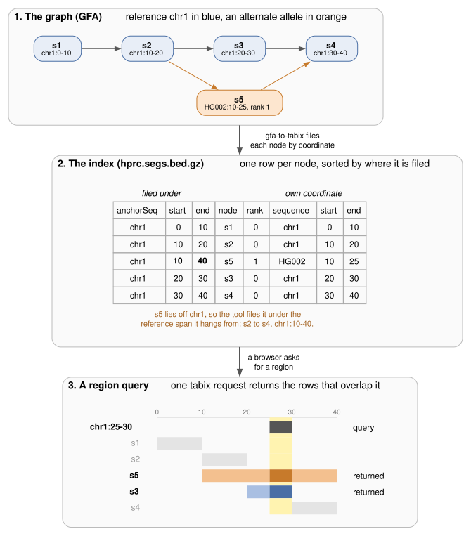

# gfa-to-tabix

- **In:** a pangenome graph as GFA, from minigraph, Minigraph-Cactus, pggb, odgi or vg
- **Out:** bgzip-compressed, Tabix-indexed BED files a genome browser reads by region with HTTP range requests
- One static binary does the whole conversion. It needs no gfatools, awk, bgzip or tabix
- The [JBrowse 2](https://jbrowse.org) graph track reads the files



`dot -Tsvg docs/overview.dot -o docs/overview.svg` redraws the figure.

## Install

A static binary for Linux x86_64 or macOS on Apple silicon, from the
[releases](https://github.com/GMOD/gfa-to-tabix/releases):

```bash
curl -fL https://github.com/GMOD/gfa-to-tabix/releases/latest/download/gfa-to-tabix-x86_64-unknown-linux-musl.tar.gz | tar xz
```

or from crates.io with Rust 1.91 or later:

```bash
cargo install gfa-to-tabix
```

## Usage

```bash
# an rGFA: minigraph, or the minigraph stage of Minigraph-Cactus
gfa-to-tabix hprc-v2.1-mc-grch38.sv.gfa.gz -o hprc

# a plain GFA with paths: pggb, odgi, vg, base-level Minigraph-Cactus
gfa-to-tabix ecoli.gfa.gz --reference K12 -o ecoli
```

Each command writes the nodes and links, indexed:

```
hprc.segs.bed.gz    hprc.segs.bed.gz.tbi
hprc.links.bed.gz   hprc.links.bed.gz.tbi
```

| Option                 | Effect                                                                                  |
| ---------------------- | --------------------------------------------------------------------------------------- |
| `--reference <name>`   | For a plain GFA: the PanSN sample, assembly or path to use as reference. Default the first path. |
| `-o`, `--out <prefix>` | Output prefix. Default the input name without `.gfa[.gz]`.                              |
| `--layout <layout>`    | `anchored` (default) or `contig`; see [layouts](docs/index-format.md#layouts).          |

The input may be gzipped, and `-` reads stdin.

## Everything a graph track needs

```bash
gfa-to-tabix build hprc-v2.1-mc-grch38.sv.gfa.gz -o hprc --assembly hg38
```

`build` reads the graph once and writes the index, a zoomed-out tier, the
alleles, the bubbles, a manifest and a JBrowse track config.

## Haplotype paths

```bash
gfa-to-tabix chr22.gfa --walks --refs GRCh38,CHM13 -o chr22
```

`--walks` writes one file per reference holding every haplotype's path through
a base-level graph.

## Docs

- [Subcommands](docs/subcommands.md): `build`, `alleles`, `bubbles`, `fold`, `paths`
- [Walks](docs/walks.md) and [the walks row format](docs/walks-format.md)
- [The node and link index](docs/index-format.md): coordinates, layouts, columns, scale
- [JBrowse configuration](docs/jbrowse.md)

## See also

- [jbrowse-plugin-graphgenomeviewer](https://github.com/GMOD/jbrowse-plugin-graphgenomeviewer): the JBrowse 2 plugin that browses these graphs by locus
- [@gmod/gbz-base](https://github.com/GMOD/gbz-base-js): range-request reader for `.gbz.db` databases
- [gbz-haplotype-index](https://github.com/GMOD/gbz-haplotype-index): names every walk in a gbz-base cut
- [gfa-to-pairwise-paf](https://github.com/cmdcolin/gfa-to-pairwise-paf-rs): graph to PAF, for synteny views
- [JBrowse pangenome tutorials](https://jbrowse.org/jb2/docs/tutorials/pangenome_prepare_graph/)

## License

Apache-2.0
