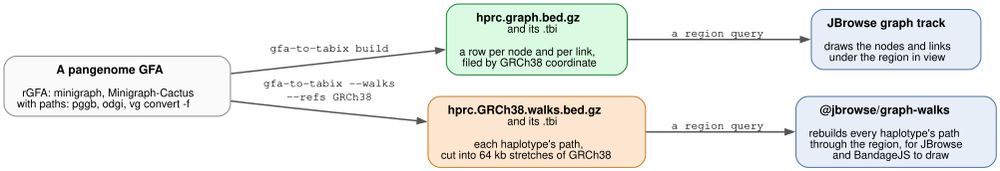
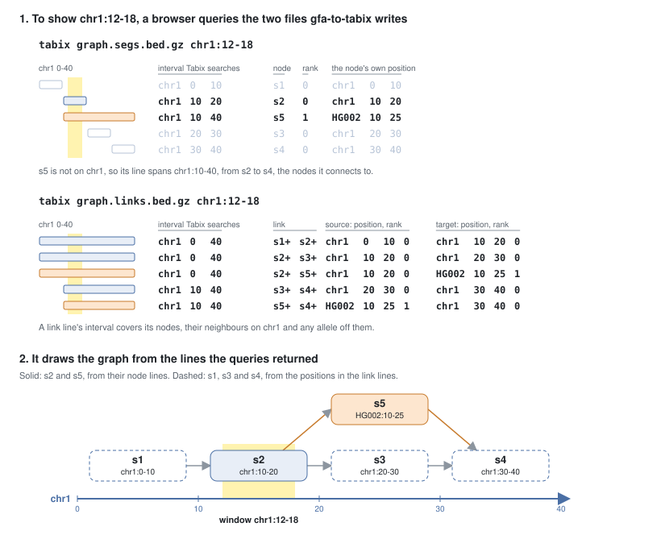
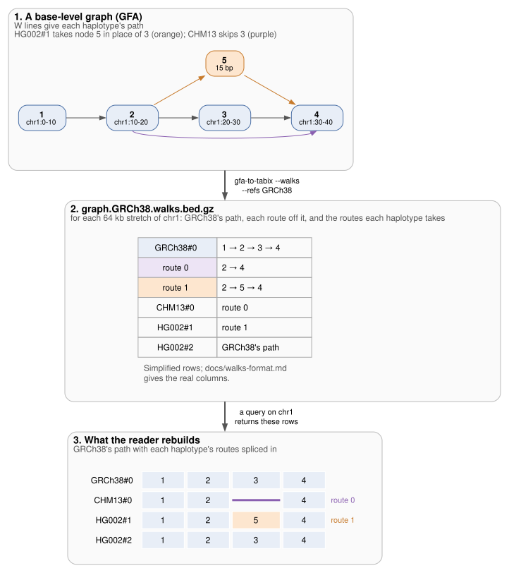

# gfa-to-tabix

gfa-to-tabix indexes a pangenome graph by genome coordinate, so a browser can fetch the subgraph for any region.

- **In:** a GFA file (`.gfa` or `.gfa.gz`): an rGFA from minigraph or Minigraph-Cactus (`*.sv.gfa.gz`), or a plain GFA with P or W lines from pggb, odgi or `vg convert -f`
- **Out:** `<prefix>.graph.bed.gz` and its `.tbi`, one line per node and per link ([format](docs/index-format.md#what-the-file-holds)); `--format 1` writes the `.segs.bed.gz` and `.links.bed.gz` pair that readers before graph-walks 4.4 and the JBrowse plugin 8.2 need
- **Out, with `--walks --refs GRCh38`:** `<prefix>.GRCh38.walks.bed.gz` and its `.tbi`, every haplotype's path through a base-level graph, which [@jbrowse/graph-walks](https://github.com/GMOD/graph-walks) reads
- A browser fetches the rows for a region with HTTP range requests and never downloads the whole graph
- The [JBrowse 2](https://jbrowse.org) graph track reads the file
- The tool is one static binary and needs no bgzip or tabix; `build` runs gfatools, when installed, for an rGFA's bubbles





## Quick start

```bash
curl -fL https://github.com/GMOD/gfa-to-tabix/releases/latest/download/gfa-to-tabix-x86_64-unknown-linux-musl.tar.gz \
  | tar xz --strip-components=1 gfa-to-tabix-x86_64-unknown-linux-musl/gfa-to-tabix

# rGFA from minigraph or Minigraph-Cactus (*.sv.gfa.gz): coordinates come from its SN/SO/SR tags
./gfa-to-tabix build hprc-v2.1-mc-grch38.sv.gfa.gz -o hprc --assembly hg38

# plain GFA from pggb, odgi or vg: coordinates come from the reference's path
./gfa-to-tabix build ecoli.gfa.gz --reference K12 -o ecoli
```

- `build` writes the index and everything else a JBrowse graph track reads, including a [track config](docs/subcommands.md#the-jbrowse-config) for the assembly `--assembly` names
- `./gfa-to-tabix hprc-v2.1-mc-grch38.sv.gfa.gz -o hprc`, without `build`, writes only the index: `hprc.graph.bed.gz` and its `.tbi`
- [Releases](https://github.com/GMOD/gfa-to-tabix/releases) also has a macOS binary for Apple silicon, and `cargo install gfa-to-tabix` builds one with Rust 1.91 or later

## Haplotype paths

```bash
./gfa-to-tabix chr22.gfa --walks --refs GRCh38,CHM13 -o chr22
```

- `chr22.gfa` is a base-level GFA with integer node ids and W or P lines, as `vg convert -f chr22.gbz > chr22.gfa` writes
- The command writes one file per `--refs` sample, here `chr22.GRCh38.walks.bed.gz` and `chr22.CHM13.walks.bed.gz`, each with a `.tbi`
- A region query returns the rows a reader needs to rebuild every haplotype's path through that region. [@jbrowse/graph-walks](https://github.com/GMOD/graph-walks) rebuilds them, and BandageJS and the JBrowse graph plugin draw through it



## FAQ

### What does gfa-to-tabix add to an rGFA?

- An rGFA, as minigraph writes it, gives every node a place on a genome in
  three tags: `SN` names the sequence, `SO` the offset and `SR` the rank, 0 for
  the reference and higher for a node another assembly contributed
- An rGFA has no index, so a program that shows one region parses the whole
  file first. `gfatools view -R chr1:101-200` cuts a region out of a local
  rGFA that way
- gfa-to-tabix writes the nodes and links as Tabix-indexed BED, so a browser
  fetches one region's rows over HTTP from a static host
- A node of rank 1 or more has `SN` and `SO` on the assembly that contributed
  it, such as `HG002#1#chr1`, so a GRCh38 query by tag coordinates misses it.
  The default layout files such a node under the GRCh38 interval its bubble
  hangs from, and `--layout contig` keeps the tag coordinates
  ([layouts](docs/index-format.md#layouts))

### Can I index a GFA without rGFA tags?

- Yes, when it has P or W lines, as pggb, odgi and `vg convert -f` write
- The tool walks the reference's paths and gives each node the values an
  rGFA's tags would hold: the path name, the offset along it, and rank 0 on the
  reference or 1 elsewhere
- `--reference` names the reference, a PanSN sample such as `GRCh38`, an
  assembly such as `HG002#1` or a path; the default is the first path
- The tool sums node lengths along a path, so it refuses an L or P line with
  an overlap other than `*` or `0M`; blunt the graph first
- [Plain GFA with paths](docs/index-format.md#plain-gfa-with-paths) has the
  rules for collapsed repeats and reversed nodes

### What differs between an rGFA and a plain GFA in the output?

|                           | rGFA                                                          | Plain GFA                                      |
| ------------------------- | ------------------------------------------------------------- | ---------------------------------------------- |
| Written by                | minigraph, Minigraph-Cactus `*.sv.gfa.gz`                     | pggb, odgi, `vg convert -f`                    |
| Node coordinates from     | the `SN`, `SO` and `SR` tags                                  | the reference's P or W lines                   |
| Assemblies with each node | not in the index                                              | an `SB:H:` bitmask on every row                |
| `build`'s bubbles         | `gfatools bubble`, when on PATH                               | a `vg deconstruct -a` VCF, given as `--snarls` |
| `build --tier` default    | 10000 bp                                                      | 50 bp                                          |
| Walk files (`--walks`)    | minigraph writes no paths and names nodes `s1`, `s2`, so none | from a base-level graph with integer node ids  |

### Why does the graph track draw some bubbles as stubs? (`--max-component`)

**What the option does**

- The default layout files each node off the reference under the reference
  interval its bubble hangs from, so one query for a region returns the whole
  bubble
- Nodes off the reference that link to each other without passing through it
  form a component, which is usually one bubble's alleles
- The tool files a component of more than `--max-component` nodes, default
  10,000, under its own coordinates instead. Each of its nodes sits at its
  position on the first haplotype path that reaches it

**What you see in JBrowse**

- At a locus under a moved component, the graph track draws the reference and a
  faded dead-end node at each place the component joins it, whose hover says
  the component is too large to draw there. The rest of the component is
  missing from the view (graph-walks 4.3, the plugin 8.1)
- The tool lists each moved component and the reference interval it would
  have filed under, here for HPRC's pggb chrY:

```
3 of the graph's components are over --max-component 10000, so a graph track draws them as stubs; --max-component none files them under the reference:
  3506022 nodes under GRCh38#0#chrY:26640509-56821961
  202687 nodes under GRCh38#0#chrY:12508026-56887902
  31798 nodes under GRCh38#0#chrY:11531191-11650765
```

- The walk files (`--walks`) and `--layout contig` have no limit, so a
  haplotype view still draws every path through the region

**Why the default is on**

- Every query under a component reads all of it. pggb grows components of
  millions of nodes across reference gaps and repeat arrays. On HPRC's pggb
  chr22, one of 2.48 M nodes hangs from 10.5 to 50.8 Mb, nearly the whole
  chromosome, and a browser can't load the rows a window under it returns
- Node and link rows a 10 kb window reads, without the limit and with it:

| graph | components moved | window | without | with |
|---|---|---|---|---|
| HPRC SV rGFA, whole genome | 1, of 22,501 nodes | under that bubble, chr1:2.70 Mb | 22,690 and 34,015 (6.4 MB) | 189 and 291 (53 KB) |
| HPRC pggb chrY | 3, of 3.74 M nodes | in the Yq12 gap, 40.00 Mb | 3.7 M and 7.1 M (10 GB) | 1 and 4 |
| HPRC pggb chr22 | 4, of 2.53 M nodes | median of 50 | 2.5 M and 3.9 M | 438 and 626 |
| HPRC v2.1 Minigraph-Cactus chr22 | 14, the largest 208,833 nodes | p90 of 50 | 22,827 and 31,583 | 1,006 and 1,445 |

**When to change it**

- **Keep the default** for pggb and Minigraph-Cactus graphs of human
  chromosomes
- **Raise it** to draw a moved bubble whole. In the chrY list above, the third
  component is a 120 kb bubble, while the first two span 30 and 44 Mb.
  `--max-component 50000` draws the bubble whole, and every window under it
  reads its 31,798 nodes, while the two giants stay moved
- **`--max-component none`** files every component under the reference, as
  earlier versions did. Use it when you want every component the tool reports
  drawn whole and accept what a window under each one reads
- **Lower it** when windows still load slowly. A window reads about N node
  rows at most, plus their links, so a lower N lowers that cap and turns more
  bubbles into stubs
- `build` and `fold` take the same option and apply it to the coarse tier too

**Side effects**

- A moved component's nodes spread over the contigs of the assemblies whose
  paths reach them first, and a link between two contigs gets a row on each.
  pggb chrY's format 1 link file grows from 378 to 682 MB, while chr22's
  shrinks from 3.9 to 1.6 GB
- No reader yet expands a stub into the moved component
  ([ADR 0005](docs/adr/0005-giant-components.md) has the measurements)

### Which output do I need?

- The node and link index holds the nodes and links a graph track draws at a
  locus, for any input graph. `build` writes it with the coarse tier, alleles,
  bubbles and a JBrowse config
- The walk files hold each haplotype's path through a base-level graph, which a
  viewer needs to draw haplotypes
- [gbz-comparison.md](docs/gbz-comparison.md) compares the walk files with
  gbz-base, which serves a GBZ from SQLite

### How large a graph does it handle?

- For the node and link index, the tool holds the whole graph in memory:
  HPRC's whole-genome SV rGFA indexes in under a minute in about a gigabyte,
  and HPRC's pggb chr22 in 6.5 minutes and 18.7 GB
- `--walks` streams the paths from disk, reading the GFA twice; HPRC v2.1's
  Minigraph-Cactus graph took 29 minutes and 13 GB on 24 cores
- A Tabix index holds coordinates up to 512 Mb, so a file with a row past that,
  such as one on wheat's 830 Mb chromosome 3B, gets a `.csi` index instead,
  which holds up to 34 Gb. htslib and JBrowse read both, and JBrowse needs
  `"csi": true` in the track's adapter

## Docs

- [The node and link index](docs/index-format.md): inputs (rGFA, plain GFA, choosing a reference), options, coordinates, layouts, columns, scale
- [Subcommands](docs/subcommands.md): `build` and its JBrowse config, `alleles`, `bubbles`, `fold`, `paths`
- [Walk files](docs/walks-format.md): options, placement rules, the row format 5 and its readers
- Decisions:
  - [ADR 0001](docs/adr/0001-step-placement.md): which chunk a walk file files each step under
  - [ADR 0002](docs/adr/0002-two-index-files.md): why format 1 keeps nodes and links in two files
  - [ADR 0003](docs/adr/0003-long-node-lookback.md): how far a walk reader reads back
  - [ADR 0004](docs/adr/0004-abridged-detours.md): moving a chunk's costliest paths to detail rows
  - [ADR 0005](docs/adr/0005-giant-components.md): a giant component keeps its own coordinates (`--max-component`)
  - [ADR 0006](docs/adr/0006-walks-skip-rows.md): `skip` rows for a haplotype whose deletion spans the window
  - [ADR 0007](docs/adr/0007-node-link-format-2.md): node and link format 2, one file with carriers as bits
- [Open problems](docs/open-problems.md): measured but undecided, such as pggb's collapsed repeats
- [Comparison with gbz-base and gbz-haplotype-index](docs/gbz-comparison.md)
- `scripts/figures.py target/release/gfa-to-tabix` redraws the figures from the tool's output, and CI fails when a figure differs from that output

## See also

- [jbrowse-plugin-graphgenomeviewer](https://github.com/GMOD/jbrowse-plugin-graphgenomeviewer): the JBrowse 2 plugin that browses these graphs by locus
- [JBrowse pangenome tutorials](https://jbrowse.org/jb2/docs/tutorials/pangenome_prepare_graph/)
- [BandageJS](https://github.com/GMOD/BandageJS) and [sequenceTubeMap](https://github.com/cmdcolin/sequenceTubeMap): graph viewers in the browser
- [gfa-to-pairwise-paf](https://github.com/cmdcolin/gfa-to-pairwise-paf-rs): graph to PAF, for synteny views

## License

Apache-2.0
