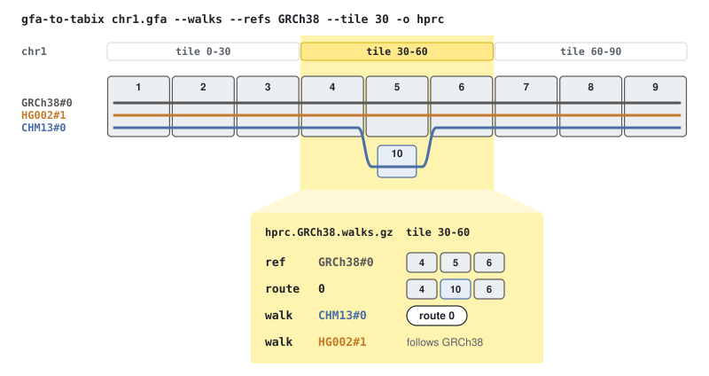

# Walk files in brief

A walk file holds the W and P lines of a GFA, arranged by where they lie on
one reference path, so that a viewer can fetch the haplotype paths through a
window of that reference with a few HTTP range requests.
[walks-format.md](walks-format.md) is the specification, and it is the
authority wherever this page is less exact.

```bash
gfa-to-tabix chr22.gfa --walks --refs GRCh38 -o chr22
```

The command writes `chr22.GRCh38.walks.gz`, which is text lines in gzip
blocks, and `chr22.GRCh38.walks.gz.idx`, a small text directory of byte
ranges.

[scripts/walks-brief.py](../scripts/walks-brief.py) implements this page in
about 150 lines of Python and prints every W and P line back from a walk
file.

## Five parts



- **Tiles.** gfa-to-tabix cuts each reference path into tiles of `tile` bp,
  65536 by default. A tile holds the reference steps that start inside it,
  so a node is never split between two tiles. The writer compresses each
  tile separately, and a table lists the byte range of each one.
- **The reference path through a tile.** The tile's `ref` rows list the
  reference's steps there with their lengths. This page and the
  specification call the list R, and every step of R has an offset on the
  reference, counted from the row's `hapOffset`.
- **Routes.** A `route` row is one detour off R: the step of R where the
  detour starts (`entry`), the steps off R (`interior`), and the step of R
  where it returns (`exit`). A tile lists each distinct detour once, however
  many haplotypes take it.
- **Walks.** A `walk` row is the part of one W or P line that lies in the
  tile, called a piece. The row gives the piece's first step on R and the
  routes it takes, in order. Between routes the piece follows R, so a
  haplotype that matches the reference across a tile is one short row.
- **Departure records.** When a path's next step on the reference is in
  another piece and is not the next base of the reference, a `departure` row
  gives the two breakpoints and how many bp of the path lie between them.
  With the record, a reader that holds one of the two pieces can draw where
  the path goes.

## Fetching a window

- GET the `.idx` directory. It has one line per reference sequence with the
  byte range of that sequence's table.
- GET the table. It has one `#entry` line per unit of the sequence:
  `seq start end kind name offset length`. A unit is one separately
  compressed run of lines, such as a tile.
- Pick the `tile` and `departures` units whose `start end` overlap the
  window, GET their byte ranges and gunzip each.

A reader picks tiles by the `start end` in the table. A tile whose last
node runs past the tile's edge has a longer extent, and a reader that
computes `floor(position / tile)` misses that node.

## Rows

Every row starts `seq start end kind`: the reference sequence, the stretch
of it the row is about (0-based, half-open, as in BED) and the row's kind.
Columns are separated by tabs.

```
seq start end ref       path fragStart hapOffset piece nsteps steps lengths passes
seq start end nodes     ids lengths
seq start end route     entry interior exit
seq start end walk      path fragStart hapOffset piece nsteps startHandle choices
seq start end departure path hapStart ownBp missingBp leavePos leaveStrand leavePasses rejoinPos rejoinStrand rejoinPasses ownTiles
```

- `path` and `fragStart` identify one W or P line: its path name, such as
  `sample#haplotype#contig`, and the offset on that contig where the line
  starts.
- `hapOffset` is where the piece starts on its contig, `piece` numbers the
  line's pieces from 0, and `nsteps` counts the piece's steps.
- A step is written as a handle, `2 × id + strand`, where strand 1 is the
  reverse strand. Lists of handles store differences: each token is
  `2 × (id − previous id) + strand`, and the first token counts from id 0.
  A token can be negative, so a reader splits it with a floor division.
- A `nodes` row gives the length of each node the tile's routes visit off
  R. Its `ids` are plain differences, with no strand bit.

## One tile, decoded

`tests/data/walks-two-refs.gfa` has a reference `>1>2>3>4>5` of 6 bp nodes
and four haplotypes. Built with `--tile 10`, the tile named 10 holds nodes 3
and 4, at offsets 12 and 18:

```
#unit         GRCh38#0#chr  12  24  tile  10
GRCh38#0#chr  12  24  ref    GRCh38#0#chr  0    12   1  2  6,2  6,6  .
GRCh38#0#chr  12  24  nodes  7             3
GRCh38#0#chr  12  24  route  6             8    -6
GRCh38#0#chr  12  24  walk   D#1#d         0    12   1  2  6    .
GRCh38#0#chr  12  24  walk   H#1#h         100  112  1  3  6    0
GRCh38#0#chr  12  18  walk   I#1#i         0    6    1  1  7    .
```

- **`ref`:** the steps `6,2` are node 3 forward (6 = 2 × 3) and node 4
  forward (2 = 2 × (4 − 3)), each 6 bp, starting at offset 12. R is `>3 >4`.
- **`nodes`:** node 7 is 3 bp.
- **`route`:** the detour leaves R at `>3` (token 6), visits `>7` (token 8,
  a difference of 4) and returns at `>4` (token −6, a difference of −3).
- **`walk` of H:** piece 1 of the line `H#1#h` has 3 steps, starts on handle
  6 (`>3`) and takes route 0. Its steps are `>3 >7 >4`.
- **`walk` of D:** the piece starts on `>3`, takes no route and has 2
  steps, so it follows R: `>3 >4`.
- **`walk` of I:** the piece is 1 step and starts on handle 7, which is
  node 3 on the reverse strand: `<3`.

The decoding rule, for any walk row:

- Start on `startHandle`.
- Follow R one step at a time: forward when the current step has the strand
  R has there, and backward with strands flipped when it has the other.
- When the current step is the next route's `entry`, emit the route's
  `interior` and continue from its `exit`.
- Stop after `nsteps` steps.

A choice token is `2 × (route number − previous route number) + flip`. A
flipped route is taken from its `exit` to its `entry` with every strand
reversed, so one row serves both directions of travel.

A route whose `entry` is `.` starts a piece off R, and a route whose `exit`
is `.` ends the piece off R.

## Departure records

The walk file of `walks-two-refs.gfa` has these two records in its
`departures` unit over 0-10:

```
GRCh38#0#chr  0  18  departure  Q#0#chr  6  6  0  6  +  1  12  +  1  0
GRCh38#0#chr  0  18  departure  I#1#i    6  0  0  6  +  1  18  -  1  .
```

- **Q** leaves the reference at 6 walking forward (`leavePos` 6,
  `leaveStrand` +) and rejoins at 12 walking forward. Between the two it has
  6 bp of its own (`ownBp`), which start at offset 6 of its contig
  (`hapStart`).
- **I** leaves at 6 walking forward and rejoins at 18 walking backward, with
  0 bp between: it steps from the end of node 1 straight onto the far end of
  node 3.
- `start end` is the smallest stretch that holds both end nodes.
- `ownTiles` names the tiles whose pieces hold the path's own steps between
  the two ends: the tile of the leave step, the tile of the rejoin step,
  both or neither. Q's 6 bp are in its piece in tile 0.
- `missingBp` is the part of `ownBp` that falls between two W lines of the
  contig, where the graph has no sequence for the path.

A reader computes a departure between two steps of one piece from the
piece itself. The file has a record only where the two steps are in
different pieces.

## Three additions, each for one case

**A reference that passes a node more than once.** pggb merges the copies of
a repeat into shared nodes, so R can hold a node several times.

- In a walk row, `startHandle@k`, and `:k` or `@k` on a choice, give the
  k-th place the node occurs in R.
- The `passes` column of a `ref` row and the `leavePasses` and
  `rejoinPasses` of a record count how often the reference passes each
  node.
- Where a count is above 1, the position of a haplotype step on that node
  is the writer's choice among the copies.
- A file whose header has `revisited:i:0` has no such node. Files built
  from HPRC's Minigraph-Cactus graphs on the graph's own reference have
  that tag.

**A tile too large to send whole.** In a satellite array a tile's rows can
be several megabytes of text.

- The writer moves whole lines out of such a tile into `detail` units, one
  line per unit, starting with the lines that take a reader the most work
  to decode ([Abridged tiles](walks-format.md#abridged-tiles) defines the
  measure). It leaves an `abridged` row in place of each moved walk row.
- The tile's `blocks` unit has one row per moved piece that lists where on
  R its steps lie, as a chain of aligned blocks and gaps.
- A viewer draws the piece from its `blocks` row, and fetches the `detail`
  unit when the user asks for the nodes.

**A departure that spans many tiles.** A reader has to find a record from a
window anywhere between its two ends.

- `departures` units come in four sizes: 1, 8, 64 and 512 tiles.
- The writer copies each record into the largest aligned units that fit
  inside the record's span, as the nodes of a segment tree cover an
  interval.
- A reader fetches the units over its window, at most one of each size per
  tile, and drops the duplicate lines.

## Limits

- A W or P line with no step on a node of the reference is absent from the
  file. The header's `leftout` tag counts these lines.
- On a reference with repeated nodes, a haplotype step on a repeated node
  is placed on one copy, and a window over another copy lacks that
  haplotype there
  ([open problem](open-problems.md#placement-of-steps-on-nodes-the-reference-passes-more-than-once)).
- A record lies between two steps on one reference sequence. A path that
  moves to another reference sequence and stays there has no record on the
  first
  ([open problem](open-problems.md#a-path-that-crosses-onto-another-reference-sequence)).

## In the specification and absent here

- [Path names](walks-format.md#path-names): how gfa-to-tabix reads a start
  offset from a P line's name.
- [Tiles and pieces](walks-format.md#tiles-and-pieces): how gfa-to-tabix
  chooses a copy for a step on a repeated node, and which GFAs it refuses.
- [route](walks-format.md#route) and [walk](walks-format.md#walk): the tie
  breaks that give each piece exactly one encoding, none of which a reader
  needs to decode a row.
- [Header](walks-format.md#header): the header tags, and how a later
  version may add tags, lines and units.
- [What a reader relies on](walks-format.md#what-a-reader-relies-on) and
  [What the writer guarantees](walks-format.md#what-the-writer-guarantees):
  every invariant, and the check that tests each one.
