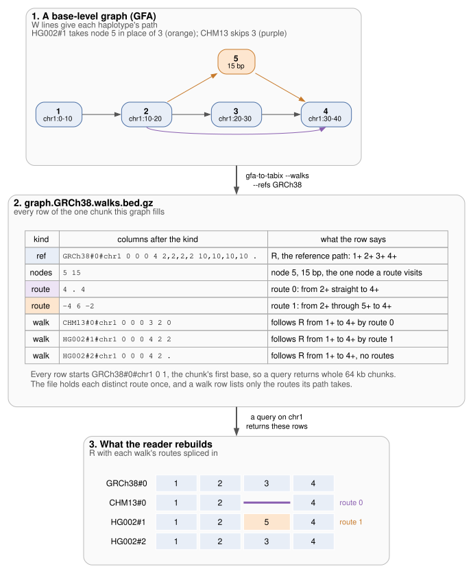

# Walk files

- **In:** a base-level GFA with integer node ids and W or P lines, such as
  `vg convert -f` writes from a Minigraph-Cactus GBZ
- **Out:** one bgzipped, Tabix-indexed file per reference sample,
  `<prefix>.<sample>.walks.bed.gz`, holding every path of the graph cut into
  pieces filed under fixed chunks of that reference
- A region query returns the rows a reader needs to rebuild every step of
  every path through the region exactly, each on the pass of the reference
  the placement gave it, and a second query returns every place a path
  departs from the reference that the rows can't show
- Every node on the reference and every end of a departure record states
  how many times the reference passes it. Where that is 1 the position is
  a fact of the graph; above 1 it is the placement's choice, and so is any
  departure with an end there ([Exact and chosen](#exact-and-chosen))
- gfa-to-tabix 3.0 and later write walk format 6, which this page describes.
  1.4 to 2.x wrote format 5, which had `skip` rows in place of departure
  records ([ADR 0009](adr/0009-departure-records.md))
- [ADR 0010](adr/0010-walks-unit-table.md) replaces this page's container
  with walk format 7, gzip units and a unit table in place of Tabix, for
  gfa-to-tabix 4.0; the rows inside a unit stay as this page gives them

```bash
vg convert -f chr22.gbz > chr22.gfa
gfa-to-tabix chr22.gfa --walks --refs GRCh38,CHM13 -o chr22
```

The command writes a file and its index for each sample in `--refs`:

```
chr22.GRCh38.walks.bed.gz  chr22.GRCh38.walks.bed.gz.tbi
chr22.CHM13.walks.bed.gz   chr22.CHM13.walks.bed.gz.tbi
```

- A chunk holds the reference's path through it once, each distinct route a
  haplotype takes off that path once, and every other path's piece as the list
  of routes it takes
- Every file lists the same paths, including those of the `--refs` samples.
  Rows in `chr22.GRCh38.walks.bed.gz` have GRCh38 coordinates, so a reader on
  GRCh38 downloads that file's index and no other
- A reader lists the haplotypes from the header without reading any rows

| Option            | Effect                                                                   |
| ----------------- | ------------------------------------------------------------------------ |
| `--refs <names>`  | Comma-separated PanSN samples, one file per sample. Required.            |
| `--chunk <bp>`    | Chunk size. Default 65536.                                               |
| `--sequences`     | Add the bases of the reference's nodes and of the nodes routes visit.    |
| `--stay <bp>`     | Keep a piece in its chunk across a short stretch elsewhere over nodes the reference passes more than once, each moved to a pass in the chunk. Default 311, the `-k 311` minimum match of the HPRC pggb graphs; 0 turns it off. |
| `--abridge-steps <n>` | Move a chunk's costliest paths to its detail rows until the rest cost at most n interior steps. Default 1000000; 0 turns it off. |
| `--abridge-bytes <bytes>` | ...and until the rest compress to at most this many bytes. Default 3000000; 0 turns it off. |



[Example](#example) lists a harder chunk, whose one route has no entry and is
taken flipped, and its departure records.

## Chunks and pieces

[ADR 0001](adr/0001-step-placement.md) gives the reasons for these rules, the
alternatives tried and their measurements on pggb and Minigraph-Cactus, and
[ADR 0009](adr/0009-departure-records.md) the changes format 6 made.

- The tool cuts each reference sequence into chunks of `chunk` bp and files
  every row under its chunk's first base, `seq cs cs+1`, so a query on a window
  returns whole chunks. A row spanning the whole chunk would share a Tabix bin
  with the next chunk, and a query would read both
- A step on a reference node takes a pass of the reference over the node, its
  **position**, and the chunk holding it. A step on any other node takes the
  chunk of the last reference step before it, or of the first one after it
  for steps that lead the path
- On the reference paths, a step takes the chunk that holds its offset, so
  where the reference passes a node twice each pass lies where it is
- A piece is a run of a path's steps in one chunk. `piece` numbers the pieces
  along one W line from 0, so a reader keys a piece by `path`, `fragStart`
  and `piece`, and joins consecutive pieces back into one walk
- A contig can span several W lines, one per stretch the graph holds, as
  where Minigraph-Cactus clips a haplotype. On its first read of the GFA
  the tool refuses two W lines of a contig that overlap or start at the
  same base, and a W line whose end column is not its start plus its
  nodes' lengths. The rows are the same for any order of the W lines,
  which `vg convert` changes from run to run
- A path that visits no node of a reference has no rows in that reference's
  file, and the tool counts these paths on stderr
- A node the reference passes once has that pass as its position. For a node
  it passes more than once, the path's last placed step predicts an offset: the
  step's own offset plus the bp the path has walked since, in the direction
  their strands agree on. The step takes the pass on the same reference
  sequence nearest that offset, the earlier on a tie, or the first pass when
  that sequence has none.
- Placing starts at the path's first step on a node the reference passes once
  (or on any reference node when there is none) and runs outward in both
  directions
- A run of steps that the rules above file in other chunks stays in the current
  piece, its home, when:
  - the path returns to the home chunk
  - the run holds at most `stay` bp of reference nodes, none of them a node
    the reference passes once
  - each of its steps on a node the home chunk's reference path holds has a
    pass there within `stay` bp of the offset the run's previous placed step
    predicts for it
- Such a step moves to the nearest such pass, and a step on a node the home
  chunk's reference path lacks becomes route interior. Any other run starts a
  new piece, and the reference's own paths are exempt. A reference that passes
  each node once therefore gets the same rows at any `stay`
- The walk row states each step's position ([walk](#walk)), so a reader never
  chooses a pass itself, and the tool fails the build if a row decodes to
  another node or position than the one it placed. A step the placement
  leaves off the reference is route interior, even where the chunk's
  reference path holds its node
- A route can hold another chunk's reference nodes. A reader places a node at
  its reference position from a `ref` row of a chunk it read whenever one
  exists, from the row whose path sorts first, at its earliest start, when
  several do. Other nodes take haplotype offsets

## Paralogs and collapsed repeats

- **Paralog jumps:** in a segmental duplication, a haplotype can step onto the
  reference nodes of a distant paralog and back. The steps after the jump take
  the paralog's chunk, so a window at the haplotype's own locus shows the
  haplotype in more pieces, and a departure record for each jump. On
  Minigraph-Cactus graphs this is rare and sits almost entirely in low-copy
  repeats such as 22q11's
- **Collapsed repeats:** pggb merges the copies of a repeat into shared nodes,
  so the reference path passes those nodes more than once, often megabases
  apart. pggb graphs have many such nodes; Minigraph-Cactus's GRCh38 path has
  none. Filing every step at the node's first pass, as format 3 did, split each
  haplotype into a piece per hop and made pggb walk files dozens of times
  larger than Minigraph-Cactus's; the nearest pass and `stay` above replace it.
  Which copy a step takes is a placement choice: the file states the choice,
  and the pass counts on `ref` rows and departure records let a viewer say
  where a region's placement or a departure is one
- **Satellite arrays:** pggb gives each haplotype a separate long path through
  thousands of tiny nodes, and the tool files all of it in the chunk where the
  haplotype leaves the reference. [Abridged chunks](#abridged-chunks) moves the
  costliest of these paths to detail rows, and a viewer draws each as a
  labelled block until the user opens it
- **What to expect on pggb:** a window shows nearly every haplotype whose
  sequence aligns there, except in satellites and CHM13's short arm, where
  abridged paths show as blocks until opened

## Exact and chosen

A walk file projects every path onto one reference. Where the reference
passes a node once, a step on it has one place, and a departure between
two such steps is a fact of the graph. Where it passes a node more than
once, the writer's placement rule picks the pass, and the departures it
files there follow from the pick: on a collapsed repeat, a path that
follows one copy can show as hopping between copies.

- The header's `revisited` counts the nodes the reference passes more than
  once. A file with `revisited:i:0` states every position and every
  departure as a fact of the graph, as the Minigraph-Cactus graphs do on
  their own reference
- Otherwise each `ref` row's `passes` and each record's `leavePasses` and
  `rejoinPasses` say which steps and ends lie on such nodes. A reader
  states a departure with an end passed more than once as a placement
  choice, not as a jump the haplotype makes
- The file does not promise that a pick is the copy a haplotype came
  from. For a reference other than the graph's own, build from the graph
  built on that reference where one exists: HPRC v2.1 publishes
  Minigraph-Cactus graphs on both GRCh38 and CHM13

## Header

Header lines start with `#`: `tabix -H` prints them and region queries skip
them.

```
#walks	format:i:6	chunk:i:65536	maxnode:i:1024	revisited:i:0	stay:i:311	abridge:i:1000000	abridgebytes:i:3000000
#reference	GRCh38
#haplotype	CHM13#0
#haplotype	HG00097#1
```

- `format:i:6` marks this format: these six row kinds, their columns and the
  placement rule above. A reader refuses any other format, and a file with a
  row kind or a placement rule this page doesn't give is another format
- `maxnode` is the longest node on the reference paths in bp
- `revisited` is how many nodes the reference's paths pass more than once,
  all its sequences counted. 0 means every position in the file is a fact
  of the graph ([Exact and chosen](#exact-and-chosen))
- `stay` is the `--stay` value in bp the file was written with; 0 means no
  stay. A reader ignores it
- `abridge` and `abridgebytes` are the `--abridge-steps` and
  `--abridge-bytes` budgets the file was written with; 0 means none. A reader
  ignores them
- Tags a reader doesn't know it ignores, on every row, in any order after
  the fixed columns, and on header lines too; it reads only the sequences
  `S` and `S~cs` of a chunk, and `S~departure`, and ignores any other.
  Later additions are tags, sibling sequences or files
- `#reference` names the reference sample
- `#haplotype` lists each other haplotype with rows in the file, as its PanSN
  `sample#haplotype`, once each in byte order
- `#long` gives each pass of the reference over a node longer than a chunk:
  sequence, start, end, as in `#long  GRCh38#0#chr22  10510000  11510000`. vg
  chops nodes at 1,024 bp, so its graphs have none; pggb's N runs and
  unaligned stretches are the usual ones
- A reader queries from the chunk before the window's first, and from the
  chunk before each `#long` pass that overlaps the window, whichever is
  earlier ([ADR 0003](adr/0003-long-node-lookback.md))
- `#hole` gives each stretch of a reference sequence that no line of the
  reference covers, between its lines and before its first: sequence, start,
  end, as `#long` does. A reference whose lines leave holes, such as a
  clipped haplotype, has them; a window inside one has no reference sequence
  there. A hole is not a departure of any haplotype

## Rows

Every row in a chunk starts `seq cs cs+1 kind`. A chunk lists its `ref` rows,
then at most one `nodes` row, then its `route` rows, then its `walk` rows,
then its `abridged` rows. Departure records lie under the sibling sequence
`seq~departure`, and detail records under `seq~cs`.

A handle is `2 × id + r`, with `r` 1 for the reverse strand. A list of handles
is written as delta tokens: each token is `2 × (id − previous id) + r`, and the
first token's previous id is 0 unless a row says otherwise. An empty list is
`.`.

A difference can be negative, so a reader splits a token `t` by rounding down,
taking the difference as `t >> 1` and `r` as `t & 1`. The token `-5` is a difference
of −3 on the reverse strand; dividing toward zero would read −2.

### ref

```
seq cs cs+1 ref path fragStart hapOffset piece nsteps steps lengths passes [SQ:Z:bases]
```

- One row per piece of the reference paths in the chunk, so usually one
- `path` is `sample#haplotype#contig`. `fragStart` is where the W line starts on
  that contig, or the start in a P line's name (`[start]`, `#start` or
  `:start-end`). `hapOffset` is where the piece starts
- `steps` is the piece's handles as delta tokens, the first from 0
- `lengths` lists each step's node length in bp
- `passes` lists for each step how many times the reference's paths pass
  its node, all its sequences counted, or is `.` when every one is 1. It
  counts passes anywhere, not in the chunk: a node R holds once here may
  be passed in another chunk or on another sequence
- **R**, the chunk's reference path, is every `ref` row's steps joined in
  `hapOffset` order. Positions in R count from 0, and each has its offset on
  the sequence from its row's `hapOffset` and the lengths before it

### nodes

```
seq cs cs+1 nodes ids lengths [SQ:Z:bases]
```

- The nodes the chunk's routes visit, in ascending id order: `ids` gives each
  id as the difference from the one before, the first from 0, and `lengths`
  their lengths in bp
- With `--sequences`, `SQ:Z:` holds their bases joined in the same order, as
  the S lines give them. On a `ref` row it holds the steps' nodes' bases in
  step order, each forward as its S line gives it, whatever the step's strand
- `--sequences` refuses a graph with a segment whose sequence is `*`

### route

```
seq cs cs+1 route entry interior exit
```

- A route is a way a piece leaves R: `entry`, the handle on R it leaves from;
  `interior`, the steps off R; and `exit`, the handle on R it returns to
- `entry` or `exit` is `.` for a route that starts or ends the piece off R.
  `interior` is `.` for a route straight from one part of R to another, such as
  a jump over the reference or between repeat copies
- All three columns are delta tokens chained through the chunk's route rows: a
  token's previous id is the id of the token before it, across columns and rows.
  The chunk's first route row starts from 0
- A route's id is its row's index among the chunk's route rows, from 0
- A route is stored the way round whose handles sort first: by `entry` (none
  first), then `interior`, then `exit`. Its flip is the reverse: each handle
  flipped, interior reversed, entry and exit swapped

### walk

```
seq cs cs+1 walk path fragStart hapOffset piece nsteps start[@k] choices
```

- One row per piece of every other path, the other references' included.
  `path`, `fragStart`, `hapOffset`, `piece` and `nsteps` are as on a `ref` row
- `start` is the piece's first handle on R, absolute
- `choices` lists the routes the piece takes in order, `.` for none. Each token
  is `2 × (route id − previous route id) + flip`, the first from 0, where flip
  1 means the piece takes the route the other way round. A token may end
  `:k`, then `@k`. See [Decoding a walk row](#decoding-a-walk-row)
- Where R holds a node more than once, `k` names an occurrence, counting R's
  positions holding the node from 0. `start@k` is the occurrence the piece
  starts on, where it is not R's first. On a choice, `:k` is the occurrence
  of the entry's node the walk leaves R from, where stepping along R from
  where it last landed until it reads the entry would stop at an earlier
  one, and `@k` the occurrence the route's exit lands on, where it is not
  the one nearest the entry's position in R, counted in positions, the later
  on a tie. A route with no entry takes neither and one with no exit takes
  no `@k`. The tool writes them only where they differ from those defaults,
  so a file has one encoding, and a reference that passes every node once
  has none
- The walk continues along R only where R's next position is the step's, and
  otherwise takes a route, with an empty interior if need be; after its last
  route it follows R until it has `nsteps` steps

### abridged

```
seq cs cs+1 abridged path fragStart hapOffset piece nsteps bp start[@k] end[@k] detail
```

- One row per piece the tool moved to a detail record, in place of its walk
  row. See [Abridged chunks](#abridged-chunks). A reader keys it by `path`,
  `fragStart` and `piece` as it does a walk row, so every piece of a path
  has one row in its chunk, walk or abridged
- `start` is the piece's first handle on R and `end` its last, both
  absolute. `start@k` names its occurrence as on a walk row; `end@k` names
  its occurrence where it is not the one nearest `start`'s position in R,
  counted in positions, the later on a tie
- `hapOffset` and `bp` give the piece's stretch on R: it runs from
  `hapOffset`, where its `start` step begins on its contig, to `hapOffset +
  bp`, where its `end` step ends, as a reader trims a walk row's piece to its
  steps on R. Steps of its own before `start` or after `end`, at its
  contig's start or end or beside a step on another sequence, lie outside it
- A record leaves at a piece's last step on S and rejoins at a piece's
  first, so no record's own bp share a base with an abridged row's stretch,
  and a reader that leaves the piece unexpanded nets `bp` against the R
  between `start` and `end` and takes the departures at its ends from their
  records
- `nsteps` counts all the piece's steps, those outside the stretch included:
  the steps its detail record's walk row decodes, which a reader that reads
  the record bounds its work by
- `detail` numbers the chunk's record that holds the piece's walk row. A
  path's moved pieces in one chunk share one record

### departure

```
seq~departure a b departure path hapStart ownBp missingBp leavePos leaveStrand leavePasses rejoinPos rejoinStrand rejoinPasses
```

A record for each place a path departs from a reference sequence S that its
walk rows can't show: where two of its consecutive steps on S are not
adjacent there at the passes they took and lie in different pieces. A
departure inside one piece has no record: a reader computes it from the
piece's steps ([ADR 0009](adr/0009-departure-records.md)).

- Departures are per reference sequence: for S, the path's steps on S in
  order, with its steps on the reference's other sequences counted as its own
  sequence. A contig's W lines count as one path, in start order
- Each end is a step on S: `Pos` is its breakpoint, where the path's sequence
  stops following S (the node's end for a step along S, its start for a step
  against it, and the other way round for the rejoin), and `Strand` `+` or
  `-` for the step along or against S's orientation at its pass. The leave
  is the step before the departure and the rejoin the step after, in the
  path's order. `Passes` is how many times the reference's paths pass the
  end's node, as on a `ref` row: above 1, the end's pass is the
  placement's choice, and so is the departure
- `hapStart` is where the path's own sequence between the ends starts on its
  contig, right after the leave step, and `ownBp` how far it runs, 0 for a
  direct jump: every base between the ends, on nodes of its own, on the
  reference's other sequences, in W lines with no step on S, or in no W line.
  `missingBp` is the part of `ownBp` between W lines, which the graph lacks
- Two consecutive steps on S are adjacent, and depart nowhere, when `ownBp`
  is 0, the strands are equal and the breakpoints are equal, [holes](#header)
  removed. A step on a node of 0 bp between them changes nothing
- A contig's sequence before its first step on S or after its last is no
  departure and has no record: the piece holding that step shows where the
  path comes from or goes on, as a route with no entry or no exit, and a
  piece on another sequence holds its steps there
- No column says what kind of departure it is. `leaveStrand ≠ rejoinStrand`
  is a strand switch; otherwise, for a `+` leave the path jumps back when
  `rejoinPos < leavePos`, and for a `-` leave when `rejoinPos > leavePos`,
  over reference it walks again; equal breakpoints are sequence of its own
  between adjacent steps; any other case is a jump forward. Positions
  compare with the holes before them removed. `ownBp` 0 is a direct jump;
  `missingBp` above 0 is sequence the graph lacks
- No column names the node or the chunk of an end: the
  chunk's reference path holds one node ending at a `+` leave's or `-`
  rejoin's breakpoint and one starting at the other kind's, and the step's
  piece is filed under the chunk of that node's pass, which starts in the
  chunk holding the base beside the breakpoint or, for a node that straddles
  a chunk boundary, the one before, both in a window's walk read
- A record covers its stretch, from one base of its first end's node beside
  the breakpoint to one base of the other's: `[bp − 1, bp)` where the
  breakpoint is the node's end and `[bp, bp + 1)` where it is its start, for a
  node of 0 bp `[bp, bp + 1)`, each clipped to S. That extent is cut at
  aligned multiples of 2^26, 2^23, 2^20 and 2^17 bp, the index's bin sizes,
  one row per block, `a` to `b`, so each row lands in a Tabix bin no larger
  than itself
- Every row of a record repeats the same columns after `a` and `b`, and a
  reader dedups on them. A file with more rows than these rules give is
  still valid, so the filing can change without a reader release

### Reading a window

- The walk read: every chunk the window and its context touch, from the
  chunk before, as [Header](#header) says. It gives every piece over the
  extent and every departure inside them: both steps of one lie in the
  piece's chunk, so the stretch between them lies in that chunk and the next,
  or in a `#long` pass that starts in one of them
- The departure read: `seq~departure` over the same extent, which returns
  every record whose stretch, its end bases included, overlaps it
- The two reads together give every departure over the extent, each once,
  when a reader computes departures only between consecutive steps of one
  piece: one between two pieces is a record, even where it read both. An
  abridged path's pieces lie in its detail record, so the departures inside
  them come with that record, when a viewer fetches it

## Abridged chunks

[ADR 0004](adr/0004-abridged-detours.md) gives the reasons and measurements.

- A piece costs a reader its routes' interior steps, each counted once per
  use, plus a quarter of all its steps, interior ones included. graph-walks
  decodes a step along R faster,
  but a cut still keeps and draws it
- When a chunk's pieces cost more than `abridge` interior steps, or its rows
  would compress to more than `abridgebytes`, the tool moves whole paths out
  of the chunk, costliest first, until the rest fit. A path's pieces in the
  chunk move together
- The chunk keeps its `ref` rows, its other pieces' `nodes`, `route` and `walk`
  rows, encoded without the moved pieces, and an `abridged` row per moved
  piece with its first and last handles on R, the bp from one to the other
  and its steps
- The moved pieces' rows go to detail record `detail` of the chunk, under the
  sequence `seq~cs` at position `detail × 16384`, so each record has a Tabix
  leaf bin to itself and a query for one reads no other. A window query names
  only `seq`, so it reads no record, and a viewer fetches a record on request
- A chunk with more than 32,768 records puts the last ones past the 512 Mb a
  Tabix index holds, and the file then gets a `.csi` index in place of its
  `.tbi`, as it does for a reference contig longer than 512 Mb
- A record holds a `nodes` row, `route` rows and `walk` rows. The tool numbers
  its routes from 0 and chains their tokens from 0, as for a chunk of its own,
  and its walk rows decode against the R of chunk `cs` of `seq`

## Decoding a walk row

R's step from position `i` holding handle `h` goes forward when `R[i] = h`,
to `R[i+1]`, and backward otherwise, to `R[i−1]` flipped. Each route below is
taken the way round its flip says. Every handle on R is emitted with its
position in R, and so with its offset and pass.

1. If the first route has no entry, emit its interior
2. Emit `start`, at occurrence `k` of its node in R with `@k`, else at the
   first
3. For each route with an entry:
   - step along R, emitting each handle, until the current handle is the
     route's entry, or with `:k` until the position is occurrence `k` of
     the entry's node
   - emit the interior
   - with no exit, stop: the piece ends off R
   - emit the exit, at occurrence `k` of its node in R with `@k`, else at the
     occurrence nearest the current position in R, counted in positions,
     the later one on a tie
4. Step along R until the piece has `nsteps` steps

The encoder decodes every walk row it writes with these rules and compares
each step's handle and position, and fails the build on any difference. On
HPRC v2.1's Minigraph-Cactus chr22 GRCh38 passes no node twice, and no walk
row needs `@k` or `:k`.

## Example

`tests/walks.rs` builds `tests/data/walks-two-refs.gfa` with `--chunk 10
--stay 0` and checks every row. Part of chunk 0-10 of R, and two of R's
departure records:

```
R#0#chr            0   1   ref        R#0#chr  0  0    0  2  2,2  6,6  .
R#0#chr            0   1   nodes      6  6
R#0#chr            0   1   route      .  13  -9
R#0#chr            0   1   walk       H#1#h    100  100  0  2  2  .
R#0#chr            0   1   walk       Q#0#chr  0    0    0  2  2  1
R#0#chr~departure  0   24  departure  D#1#d    24 0  0  24 +  1  0  +  1
R#0#chr~departure  5   13  departure  Q#0#chr  6  6  0  6  +  1  12 +  1
```

- R is `>1 >2`: tokens `2` and `2` are ids 1 and 2, forward, and R passes
  each once, so `passes` is `.` and every record's ends say 1
- The one route has no entry, interior `13` (id 6 reversed) and exit `-9` (id 1
  reversed), so it reads `<6 <1`
- Q's piece starts on `>1` (handle 2) and takes route 0 flipped, `>1 >6`
  with no exit: its steps are `>1 >6`
- H's piece starts on `>1` and takes no route, so it follows R for its 2
  steps: `>1 >2`
- Q leaves R at 1's end, 6, walks 6 bp of its own, node 6, and rejoins at
  3's start, 12, in a piece filed under chunk 10. Its record covers 1's last
  base to 3's first, 5-13
- D jumps back from 4's end, 24, to 1's start, 0, over nothing of its own

## Scale

- The tool reads the GFA twice, so it takes a file path and refuses stdin;
  gzip input works
- The tool holds about 16 bytes per node, 24 more per node for each reference,
  and with `--sequences` the graph's bases
- Pieces and departure records wait for an external sort in up to 512 MB and
  128 MB of memory and then in compressed runs in a temporary directory
  beside the output. The sort's merge encodes the chunks on every core, and
  the densest chunks set the peak: 22 GB on pggb chr22, against 20 GB in
  format 5
- A Minigraph-Cactus chromosome with two references takes minutes and a few GB
  of memory on a laptop
- The header fits in the file's first BGZF block, and a window reads two
  chunks, so a reader fetches a small fraction of a megabyte per window
  (`docs/format-2/scripts/window_sizes.py` measures it); the departure read
  adds one request on Minigraph-Cactus

## Readers

- [@jbrowse/graph-walks](https://github.com/GMOD/graph-walks) 5 reads format
  6: two reads per window, the chunks and the `~departure` blocks, and every
  departure over the window once, those inside one piece computed from its
  steps and the rest from the records, each with its ends' pass counts.
  It refuses a window whose reads the index puts over its budgets unless a
  caller lifts them. graph-walks 4 reads format 5 only, and refuses a
  format 6 file
- The graph genome viewer plugin,
  [BandageJS](https://jbrowse.org/demos/bandagejs/), ggbandage, ggtubemap and
  the tube map read through @jbrowse/graph-walks
- jbrowse.org hosts HPRC v2.1's files in format 5, as
  `https://jbrowse.org/demos/hprc/hprc-v2.1-mc-grch38-f5s.{GRCh38,CHM13}.walks.bed.gz`

In a JBrowse graph track, `walksUri` takes the prefix up to the reference
sample, so a track on hg38 reads the GRCh38 file of the GRCh38-referenced
graph, and a track on hs1 the CHM13 file of the CHM13-referenced one
([Exact and chosen](#exact-and-chosen)). `defaultHaplotypes` lists the haplotypes the track draws until
the user picks others:

```json
"adapter": {
  "type": "RgfaTabixAdapter",
  "walksUri": "https://example.org/hprc-v2.1-mc-grch38.GRCh38",
  "assemblyNameToPanSN": { "hg38": "GRCh38" },
  "defaultHaplotypes": ["HG002", "HG00733"]
}
```
