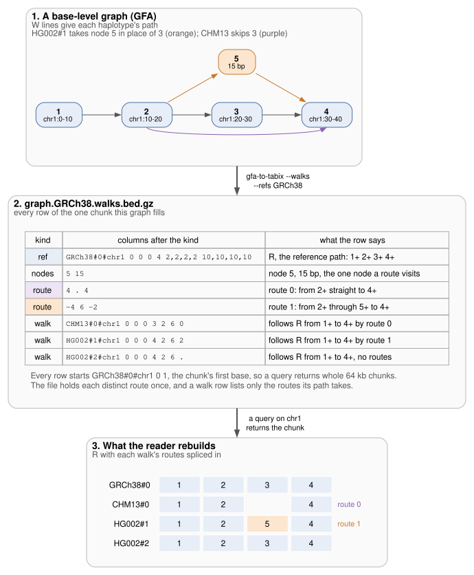

# Walk file format 4

`gfa-to-tabix --walks` writes one file per reference sample,
`<prefix>.<sample>.walks.bed.gz`, bgzipped and Tabix-indexed. It holds every
path of the graph, cut into pieces filed under fixed chunks of that reference.

- **In:** a base-level GFA with integer node ids and W or P lines
- **Out:** for each window, the reference's path through it, each distinct way
  a haplotype leaves that path (a route), and each haplotype's piece as the
  routes it takes
- A reader rebuilds every step of every piece exactly from these rows



[Example](#example) lists a harder chunk, whose one route has no entry and is
taken flipped.

## Chunks and pieces

[ADR 0001](adr/0001-step-placement.md) gives the reasons for these rules and
their measurements on pggb and Minigraph-Cactus.

- The tool cuts each reference sequence into chunks of `chunk` bp (default
  65536) and files every row under its chunk's first base, `seq cs cs+1`, so a
  query on a window returns whole chunks. A row spanning the whole chunk would
  share a Tabix bin with the next chunk, and a query would read both
- A step on a reference node takes the chunk holding that node's position. A
  step on any other node takes the chunk of the last reference step before it,
  or of the first one after it for steps that lead the path
- On the reference paths, a step takes the chunk that holds its offset, so
  where the reference passes a node twice each pass lies where it is
- A piece is a run of a path's steps in one chunk. `piece` numbers the pieces
  along the path, so a reader joins consecutive pieces back into one walk
- A node the reference passes once has that pass as its position. For a node
  it passes more than once, the path's last placed step predicts an offset: the
  step's own offset plus the bp the path has walked since, in the direction
  their strands agree on. The step takes the pass on the same reference
  sequence nearest that offset, the earlier on a tie, or the first pass when
  that sequence has none
- Placing starts at the path's first step on a node the reference passes once
  (or on any reference node when there is none) and runs outward in both
  directions
- A run of steps that the rules above file in other chunks stays in the current
  piece, joining its routes, when:
  - the path returns to the piece's chunk
  - the run holds at most `stay` bp of reference nodes, one of them a node the
    reference passes more than once
  - each chunk the run visits lies on the piece's sequence, at most
    `max(chunk, maxnode) / chunk` chunks (rounded down) after the piece's
- Any other run starts a new piece, and the reference's own paths are exempt.
  A reference that passes each node once therefore gets the same rows at any
  `stay`, and a window always reads the piece holding a step on its reference
  nodes
- A route can hold another chunk's reference nodes. A reader places a node at
  its reference position from a `ref` row of a chunk it read whenever one
  exists, from the row whose path sorts first, at its earliest start, when
  several do. Other nodes take haplotype offsets

## Header

Header lines start with `#`: `tabix -H` prints them and region queries skip
them.

```
#walks	format:i:4	chunk:i:65536	maxnode:i:1024	stay:i:311
#reference	GRCh38
#haplotype	CHM13#0
#haplotype	HG00097#1
```

- `format:i:4` marks this format. A reader refuses any other
- `maxnode` is the longest node on the reference paths in bp. A reference node
  overlapping a window starts at most that far before it, so a reader queries
  from `max(chunk, maxnode)` bp before the window, rounded down to a chunk start.
  vg chops nodes at 1,024 bp, so for its graphs that is one chunk back
- `stay` is the `--stay` value in bp the file was written with; 0 means no stay.
  A reader ignores it
- `#reference` names the reference sample
- `#haplotype` lists each other haplotype with rows in the file, as its PanSN
  `sample#haplotype`, once each in byte order

## Rows

Every row starts `seq cs cs+1 kind`. A chunk lists its `ref` rows, then at
most one `nodes` row, then its `route` rows, then its `walk` rows.

A handle is `2 × id + r`, with `r` 1 for the reverse strand. A list of handles
is written as delta tokens: each token is `2 × (id − previous id) + r`, and the
first token's previous id is 0 unless a row says otherwise. An empty list is
`.`.

### ref

```
seq cs cs+1 ref path fragStart hapOffset piece nsteps steps lengths [pv] [nx] [pg] [pr] [ng] [nr] [SQ:Z:bases]
```

- One row per piece of the reference paths in the chunk, so usually one
- `path` is `sample#haplotype#contig`. `fragStart` is where the W line starts on
  that contig, or the start in a P line's name (`[start]`, `#start` or
  `:start-end`). `hapOffset` is where the piece starts
- `steps` is the piece's handles as delta tokens, the first from 0
- `lengths` lists each step's node length in bp
- **R**, the chunk's reference path, is every `ref` row's steps joined in
  `hapOffset` order. Positions in R count from 0

### nodes

```
seq cs cs+1 nodes ids lengths [SQ:Z:bases]
```

- The nodes the chunk's routes visit, in ascending id order: `ids` gives each
  id as the difference from the one before, the first from 0, and `lengths`
  their lengths in bp
- With `--sequences`, `SQ:Z:` holds their bases joined in the same order, as
  the S lines give them. On a `ref` row it holds the steps' nodes' bases in
  step order

### route

```
seq cs cs+1 route entry interior exit
```

- A route is a way a piece leaves R: `entry`, the handle on R it leaves from;
  `interior`, the steps off R; and `exit`, the handle on R it returns to
- `entry` or `exit` is `.` for a route that starts or ends the piece off R.
  `interior` is `.` for a route straight from one part of R to another, such as
  a deletion or a jump between repeat copies
- All three columns are delta tokens chained through the chunk's route rows: a
  token's previous id is the id of the token before it, across columns and rows.
  The chunk's first route row starts from 0
- A route's id is its row's index among the chunk's route rows, from 0
- A route is stored the way round whose handles sort first: by `entry` (none
  first), then `interior`, then `exit`. Its flip is the reverse: each handle
  flipped, interior reversed, entry and exit swapped

### walk

```
seq cs cs+1 walk path fragStart hapOffset piece nsteps start end choices [pv] [nx] [pg] [pr] [ng] [nr]
```

- One row per piece of every other path, the other references' included.
  `path`, `fragStart`, `hapOffset`, `piece` and `nsteps` are as on a `ref` row
- `start` is the piece's first handle on R, absolute. `end` is its last handle
  on R minus `start`
- `choices` lists the routes the piece takes in order, `.` for none. Each token
  is `2 × (route id − previous route id) + flip`, the first from 0, where flip
  1 means the piece takes the route the other way round
- A token may end `:n`, and then every token does and `end` ends `:n` too. See
  [Decoding a walk row](#decoding-a-walk-row)

### Neighbours

`pv` and `nx` give the start of the chunk the path's previous and next piece is
filed under, as `pv:i:cs`, or as `pv:Z:seq:cs` on another reference sequence. A
row at either end of its path has no tag there. A reader that cuts a path off
at the edge of what it read follows the tag to the chunk the path goes on in.

### Records

A contig can span several W lines, one per stretch the graph holds, as where
Minigraph-Cactus clips a haplotype. `piece`, `pv` and `nx` run within one line
(one record), so the tool links a contig's records in start order:

- A record's last piece has `ng:i:bp`, the contig bp between this record's end
  and the next record's start, which the graph lacks. `nr` gives the chunk the
  next record's first piece is filed under, written like `nx`
- The next record's first piece mirrors these as `pg` and `pr`
- A record that visits no node of the reference has no rows in the file. Its
  neighbours get `ng` and `pg` but no `nr` or `pr`
- A last piece with neither `nx` nor `ng` ends the contig's last record in the
  graph. The contig itself may go on
- The tool refuses two records of a contig that overlap or start at the same
  base, and a W line whose end column is not its start plus its nodes' lengths,
  since `ng` would then depend on which one to believe
- The rows are the same for any order of the W lines, which `vg convert`
  changes from run to run

## Decoding a walk row

R's step from position `i` holding handle `h` goes forward when `R[i] = h`,
to `R[i+1]`, and backward otherwise, to `R[i−1]` flipped. Each route below is
taken the way round its flip says.

1. If the first route has no entry, emit its interior
2. Emit `start`, at the first position in R holding its node
3. For each route with an entry:
   - step along R, emitting each handle, until the current handle is the
     route's entry. With `:n`, take exactly `n` steps instead
   - emit the interior
   - with no exit, stop: the piece ends off R
   - emit the exit, and move to the position in R holding its node that lies
     nearest the current position, the later one on a tie
4. Step along R until the current handle is `start + end`, or with `:n` take
   exactly the tail's `n` steps

The encoder decodes every walk row it writes with these rules. Where stepping
until a route's entry would stop at an earlier pass over the same node, as when
a haplotype takes a repeat copy the reference passes twice, it writes the step
counts. On HPRC v2.1's Minigraph-Cactus chr22 neither GRCh38 nor CHM13 passes a
node twice, and no walk row needs counts.

## Example

`tests/walks.rs` builds `tests/data/walks-two-refs.gfa` with `--chunk 10
--stay 0` and checks every row. Chunk 0-10 of R:

```
R#0#chr  0  1  ref    R#0#chr  0    0    0  2  2,2  6,6  nx:i:10
R#0#chr  0  1  nodes  6  6
R#0#chr  0  1  route  .  13  -9
R#0#chr  0  1  walk   H#1#h    100  100  0  2  2  2  .  nx:i:10
R#0#chr  0  1  walk   Q#0#chr  0    0    0  2  2  0  1  nx:i:10
```

- R is `>1 >2`: tokens `2` and `2` are ids 1 and 2, forward
- The one route has no entry, interior `13` (id 6 reversed) and exit `-9` (id 1
  reversed), so it reads `<6 <1`
- Q's piece starts on `>1` (handle 2) and ends there (`end` 0), then takes
  route 0 flipped, `>1 >6` with no exit: its steps are `>1 >6`
- H's piece starts on `>1`, ends on `>2` (`end` 2), and takes no route: its
  steps are `>1 >2`
