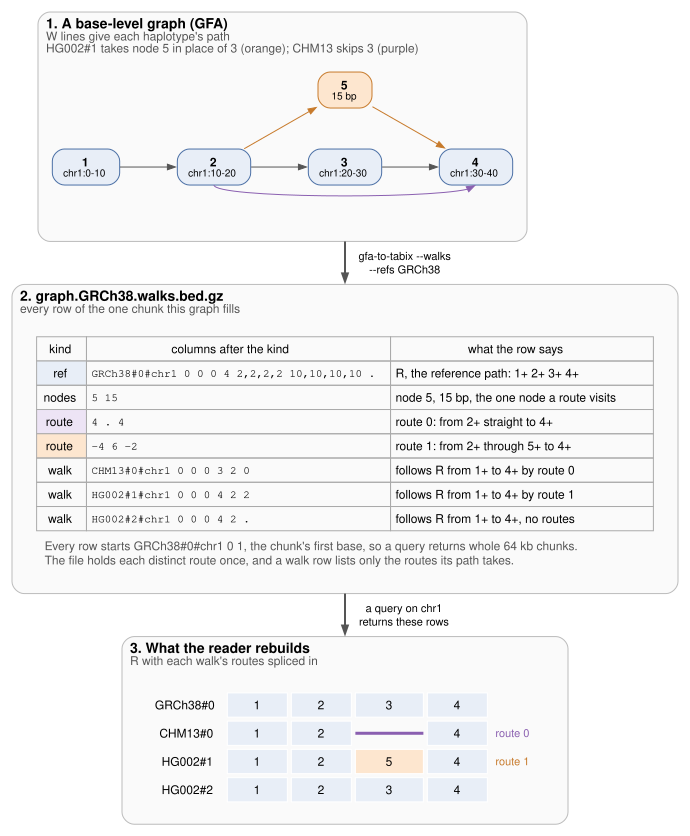

# Walk files

- **In:** a base-level GFA with integer node ids and W or P lines, such as
  `vg convert -f` writes from a Minigraph-Cactus GBZ
- **Out:** per reference sample, a walk file `<prefix>.<sample>.walks.gz`
  and its directory `<prefix>.<sample>.walks.gz.idx`. Together they hold
  every W or P line of the graph that steps on a node of that reference,
  cut into pieces filed under fixed tiles of that reference <!-- C116 -->
- A reader rebuilds every piece of every path over a window from the tiles
  whose extents overlap it, an abridged piece by expanding its `detail`
  unit. <!-- C1 --> Each step sits on the pass of the reference the placement gave it,
  and the departure records give every place a path departs from the
  reference that the tiles' rows can't show <!-- C1 -->
- Every node on the reference and every end of a departure record states
  how many times the reference passes it. <!-- C2 --> Where that is 1, the
  position is a fact of the graph. Above 1 it is the placement's choice, and
  so is any departure with an end there ([Exact and chosen](#exact-and-chosen))
- gfa-to-tabix 5.0 and later write walk format 8, which this page
  describes ([ADR 0010](adr/0010-walks-unit-table.md),
  [ADR 0012](adr/0012-abridged-blocks.md),
  [ADR 0013](adr/0013-abridged-hapbp.md)). It is a series of
  gzip units with a table of their byte ranges, not a Tabix file. 4.x
  wrote format 7, the same but for a moved piece: its `abridged` row gave
  the piece's two end steps and the bp between, and there were no
  `blocks` units. 3.x wrote
  format 6, whose rows a tile keeps from `kind` on but which filed all of
  a chunk's rows at its first base under a `.tbi`
  ([ADR 0009](adr/0009-departure-records.md)). 1.4 to 2.x wrote format 5

```bash
vg convert -f chr22.gbz > chr22.gfa
gfa-to-tabix chr22.gfa --walks --refs GRCh38,CHM13 -o chr22
```

The command writes a data file and its directory for each sample in
`--refs`, and no other file <!-- C143 -->:

```
chr22.GRCh38.walks.gz  chr22.GRCh38.walks.gz.idx
chr22.CHM13.walks.gz   chr22.CHM13.walks.gz.idx
```

- A tile holds the reference's path through it once, each distinct route a
  haplotype takes off that path once, and every other piece filed there as
  the list of routes it takes <!-- C3 -->
- A file lists every W or P line with a step on a node of its reference,
  the `--refs` samples' lines included; a line with none has no rows in
  that file, and the other lines of its contig keep theirs. <!-- C4 -->
  Lines in `chr22.GRCh38.walks.gz` have GRCh38 coordinates, so a reader on
  GRCh38 reads that file and no other
- A reader lists the haplotypes with rows in the file from the header
  without reading any tile <!-- C5 -->

| Option            | Effect                                                                   |
| ----------------- | ------------------------------------------------------------------------ |
| `--refs <names>`  | Comma-separated PanSN samples, one file per sample. Required.            |
| `--tile <bp>`     | Tile size. Default 65536.                                                |
| `--sequences`     | Add the bases of the reference's nodes and of the nodes routes visit.    |
| `--stay <bp>`     | Keep a piece in its tile across a short stretch elsewhere over nodes the reference passes more than once, each moved to a pass in the tile. Default 311, the `-k 311` minimum match of the HPRC pggb graphs; 0 turns it off. |
| `--abridge-steps <n>` | Move a tile's costliest paths to its detail records until the rest cost at most n interior steps. Default 1000000; 0 turns it off. |
| `--abridge-bytes <bytes>` | ...and until the rest hold at most this many bytes of rows, uncompressed, as [Abridged tiles](#abridged-tiles) says. Default 3000000; 0 turns it off. |

<!-- C6 C7 C8 -->

Each option takes at most 2^40, which the tool refuses above: a departure
bin of 512 tiles past any position it reads stays below 2^64, and the
header states every value exactly for a reader holding numbers as
doubles. <!-- C153 -->

`--tile` was `--chunk` in 3.x. The option sets the header's `tile:i:` and
the size of the unit a reader fetches whole, so it takes the format's word
for it.



[Example](#example) lists a harder tile, whose one route has no entry and is
taken flipped, and its departure records.

## Terms

- **S:** one reference sequence, a path name of the reference sample such
  as `GRCh38#0#chr22`. A file holds every sequence of its reference with a
  W or P line that has steps, and `|S|` is where S's last line ends, which
  its table's `#unit` line states <!-- C9 -->
- **Tile:** the `tile` bp of S from a multiple of `tile`, and the unit
  holding the rows of the pieces filed there
- **R:** a tile's reference path, its `ref` rows' steps joined in offset
  order ([ref](#ref))
- **Stretch:** a run of bases, on S unless a contig is named: a `ref`
  row's runs from its `hapOffset` over its steps' lengths
- **Span:** a walk row's stretch of S, from the first base its steps placed
  on R cover to the last, over all of them; an abridged row's and a
  blocks row's are their piece's, the same
  ([Rows](#rows)) <!-- C10 -->
- **Extent:** a unit's `start end` ([Units](#units)) or a departure line's
  ([departure](#departure))
- **File order:** the order of the units in the data file, as
  [Files and units](#files-and-units) gives it
- **Departure record:** the line for one place a path departs from S
  ([departure](#departure)). A **detail record** is one W line's moved
  pieces in one tile, a `detail` unit
- **Own steps:** a departure record's path's steps strictly between its
  leave step and its rejoin step <!-- C11 -->
- **Attach fetch:** a reader's read of the tiles a departure record's
  `ownTiles` names, for a record whose own steps it wants and whose leave
  piece or rejoin piece the window's read lacks. It takes the record's own
  steps from them and nothing else ([departure](#departure)) <!-- C117 -->
- **Drawn stretch:** one stretch of S, from the lowest start to the highest
  end over the reference nodes overlapping `D`, whole, and every step of
  a piece read whose position overlaps `D`
  ([Reading a window](#reading-a-window)) <!-- C144 -->

## Tiles and pieces

[ADR 0001](adr/0001-step-placement.md) gives the reasons for these rules, the
alternatives tried and their measurements on pggb and Minigraph-Cactus, and
[ADR 0009](adr/0009-departure-records.md) the changes format 6 made.
Which pass a step takes, where a piece is cut and what `stay` keeps
together are gfa-to-tabix's policy: a reader takes positions and pieces
from the rows, and relies on the invariants of
[What a reader relies on](#what-a-reader-relies-on), not on these rules.

- The tool cuts each reference sequence into tiles of `tile` bp, at
  multiples of `tile`. <!-- C12 --> A tile's rows are one unit of the
  file, and its extent is the stretch its rows cover ([Units](#units)),
  which can begin after the tile's start and run past its end
- A step on a reference node takes a pass of the reference over the node,
  its **position**, and the tile holding the pass's start. <!-- C13 --> A
  step on any other node takes the tile of the last step before it in its W
  line that has a position, on any sequence of the reference, or of the
  first one after it for steps that lead the line. So a step after a step
  on another sequence takes that sequence's tile, and a W line with no
  step on the reference has no tile <!-- C14 -->
- On the reference's own lines, a step takes the tile that holds its
  offset, so where the reference passes a node twice each pass lies where
  it is <!-- C15 -->
- A reference sample with several haplotypes, such as `--refs HG002` names,
  makes its haplotypes' lines reference sequences of one file, and a
  node two of them pass counts as passed twice. Another path's step there
  can take a pass on either, so a path can lie wholly under one of them
  and show in no window of the other, with no departure record
- A piece is a run of a W line's steps in one tile. `piece` numbers the
  pieces along one W line from 0 <!-- C16 -->, so a reader keys a piece by
  `path`, `fragStart` and `piece`, and joins consecutive pieces back into
  one walk
- A contig can span several W lines, one per stretch the graph holds, as
  where Minigraph-Cactus clips a haplotype. On its first read of the GFA
  the tool refuses a W line whose end column is not its start plus its
  nodes' lengths <!-- C18 -->, and two lines of a `path` with steps, W or
  P, that overlap or start at the same base. <!-- C17 --> The lines are the same
  for any order of the W lines, which `vg convert` changes from run to run
  <!-- C19 -->
- The tool refuses a W or P line that starts or ends past 2^53 on its
  contig, and a reference sequence whose last tile ends past it, so no
  coordinate a file states is above 2^53, a line's end, a unit's `end`,
  `hapOffset + hapBp` and `hapStart + ownBp` among them, and a reader
  holding numbers as doubles reads each one exactly <!-- C172 -->
- A P line states its `path` and its start in its name, which
  [Path names](#path-names) reads; the rules on this page say "W line" of
  both
- The tool drops every segment of 0 bp as it reads the GFA: its steps
  leave every W and P line, so the steps either side of one become
  consecutive, and a line left with no steps is skipped as the next rule
  says. <!-- C152 --> A reference sequence left with no bases has no
  units and no directory line. The header's `graph` still names every S
  line, 0 bp or not, as the index's does. <!-- C190 --> Neither HPRC's Minigraph-Cactus chr22 nor pggb's chrY
  has a segment of 0 bp ([counts](walks-container/writer/results/zero-bp.txt)),
  so no rule below speaks of one <!-- C152 -->
- A W or P line with an empty steps field is skipped once its end
  column is checked; `*` there is refused as a step:
  it has no rows, no departure record and no `#hole`, it names no
  reference sequence, it is not counted on stderr, and the overlap refusal
  doesn't apply to it. <!-- C118 --> It covers no base, so a contig's
  records count the same own sequence with or without it. Refusing it
  would turn away graphs `vg convert` writes for nothing a reader gains
- A W or P line with steps but no step on a node of a reference has no
  rows in that reference's file, and the tool counts these lines on stderr
  <!-- C20 -->
- A node the reference passes once has that pass as its position. For a
  node it passes more than once, the path's last placed step predicts an
  offset: the step's own offset plus the bp the path has walked since, in
  the direction their strands agree on. The step takes the pass on the
  same reference sequence nearest that offset, the lower offset on a tie,
  or, when that sequence has none, the node's first pass: the pass of the
  reference line whose name sorts first in bytes, at its lowest offset
  <!-- C21 -->
- Placing starts at the line's first step on a node the reference passes
  once (or on any reference node when there is none) and runs outward in
  both directions <!-- C22 -->
- A run of steps that the rules above file in other tiles stays in the
  current piece, its home, when:
  - the path returns to the home tile
  - the run holds at most `stay` bp of reference nodes, none of them a node
    the reference passes once
  - each of its steps on a node the home tile's reference path holds has a
    pass there within `stay` bp of the offset the run's previous placed step
    predicts for it <!-- C23 -->
- Such a step moves to the nearest such pass, the lower offset on a tie,
  and a step on a node the home tile's reference path lacks becomes route
  interior. Any other run starts a new piece, and the reference's own lines
  are exempt. <!-- C23 --> A reference that passes each node once therefore
  gets the same rows at any `stay` <!-- C24 -->
- The walk row states each step's position ([walk](#walk)), so a reader
  never chooses a pass itself, and the tool fails the build if a row
  decodes to another node or position than the one it placed. <!-- C25 -->
  A step the placement leaves off the reference is route interior, which
  it does only where the step's tile has no pass of its node: no route
  interior holds a node of its own tile's reference path <!-- C26 -->
- A route can hold another tile's reference nodes. A reader places a node
  at a reference position from a `ref` row of a tile it read whenever one
  exists: a pass over `D` before any other, then the row whose path sorts
  first in bytes, at its earliest start. Other nodes take haplotype offsets
  <!-- C119 -->

## Path names

[ADR 0014](adr/0014-p-line-names.md) gives the reasons for this reading,
the vg and odgi runs behind it and the readings turned down.

- A row's `path` and `fragStart` name one line of the GFA: `path` is the
  sequence the line is a stretch of, and `fragStart` the 0-based offset on
  that sequence of the line's first base. <!-- C180 --> A `path` is final:
  a reader takes it whole and reads no start, range or field out of it,
  whatever its text looks like <!-- C180 -->
- **A W line's** `path` is its `sample#haplotype#contig` and its
  `fragStart` its start column. GFA allows `*` for that column, which
  states no offset, and the tool refuses it <!-- C181 -->
- **A P line** has one name and no column for a start, so the tool reads
  the name from its right end, once it has summed the bp of the line's
  steps, `bp` below. A **number** is one to nineteen of the digits `0` to
  `9`, read in base 10, leading zeros allowed; text that would be a suffix
  but for a number that is no number is no suffix. The tool takes three
  steps in this order, each at most once, each on the text the step before
  left: <!-- C182 -->
  - **`:a-b`, the cut `odgi extract` writes.** Where the name ends in `:`,
    a number `a`, `-` and a number `b`, with `b − a` equal to `bp` and
    above 0, that text leaves the name and adds `a`. Where `b − a` is
    anything else the text stays in the name and adds nothing, so a
    1-based range, as `samtools faidx` names a region, is not read
    <!-- C183 -->
  - **`[s]` or `[s-e]`, vg's subrange.** Where the text ends in `[`, a
    number `s` and `]`, or in `[`, `s`, `-`, a number `e` and `]`, that
    text leaves the name and adds `s`. With an `e`, and no `:a-b` read
    before it, the tool refuses the line unless `e − s` equals `bp`, as
    it refuses a W line's end column. Beneath a `:a-b` it reads no `e`:
    the bracket is of the piece the cut was taken from, and `e` is that
    piece's end <!-- C184 -->
  - **A fourth field.** Where the text holds exactly three `#` and a
    number after the last, that `#` and the number leave the name and
    the number is added. <!-- C185 --> `#0`, which vg appends to the name of a
    haplotype it reads from a P line, adds 0 <!-- C185 -->
- The text left is `path` and the sum is `fragStart`. The tool refuses a
  line that leaves no text, such as one named `[5]`, and a sum past 2^53,
  as it refuses a W line's start past it. <!-- C186 --> A P line with no
  suffix is its name whole, from 0.
  The tool reads no suffix beneath a fourth field and no second suffix of
  a kind: a `:a-b` there is part of `path`, as it is of the contig in the
  W line of the same path <!-- C186 -->
- The fixtures of [dialect](walks-container/dialect/) hold the same paths
  as vg wrote them in W lines and in P lines, and as odgi cut vg's P
  lines. The forms of one graph give one walk file, byte for byte
  <!-- C187 -->

| P line name | bp of its steps | `path` | `fragStart` | where such a name comes from |
| --- | --- | --- | --- | --- |
| `H#1#c` | 16 | `H#1#c` | 0 | pggb, from a PanSN FASTA record |
| `H#1#c#0` | 16 | `H#1#c` | 0 | vg, of a P line it read |
| `H#1#c#100` | 14 | `H#1#c` | 100 | vg, of a GBZ haplotype clipped from 100 |
| `H#1#c[100-116]` | 16 | `H#1#c` | 100 | vg, a subrange |
| `H#1#c#100[16-22]` | 6 | `H#1#c` | 116 | `vg chunk` of that clipped haplotype |
| `H#1#c:5-21` | 16 | `H#1#c` | 5 | `odgi extract` |
| `H#1#c#0[100-114]:6-14` | 8 | `H#1#c` | 106 | `odgi extract` of a vg subrange |
| `H#1#c:5-21#0` | 16 | `H#1#c:5-21` | 0 | vg, of an `odgi extract` |
| `H#1#c:6-21` | 16 | `H#1#c:6-21` | 0 | a 1-based region name |
| `H#1#c[100-900]` | 16 | refused | | a stated end its steps contradict |
| `[5]` | 16 | refused | | a suffix alone |

- `path` is `sample#haplotype#contig` where the line is a W line or its
  name has three fields. A P line's `path` can have any number of fields:
  pggb copies FASTA record names unchanged, and odgi's and vg's own
  examples include `sample#contig`
- **What a path is listed under** in `#haplotype` is its `path` up to the
  second `#`, its PanSN `sample#haplotype`; with one `#`,
  `sample#contig`, its text up to that `#`, the sample; with none, its
  whole name. <!-- C188 --> A path's sample, which `--refs` and
  `#reference` name, is its `path` up to the first `#`, or its whole name
  <!-- C188 -->
- The tool refuses a P line whose steps hold a `;`, GFA 1.2's jump. A
  jump joins two segments no link joins, over a distance the line doesn't
  state, so no step after it has an offset <!-- C189 -->
- **A limit: phase blocks.** For haplotypes from a VCF-phased GBWT, vg
  numbers the phase blocks of a contig 0, 1, 2 and writes that counter in
  the fourth field of a P line's name and in a W line's start column.
  Nothing in such a line tells a counter from a start, and the tool reads
  a start. It refuses the graph where two blocks' stretches then overlap,
  with a message that says this. A block alone, or blocks that don't
  collide, are placed at their counter, which is false. The fourth field
  of a haplotype clipped out of a Minigraph-Cactus GBZ is a start, and
  those are the graphs this reading is for

## Paralogs and collapsed repeats
<!-- background -->

- **Paralog jumps:** in a segmental duplication, a haplotype can step onto the
  reference nodes of a distant paralog and back. The steps after the jump take
  the paralog's tile, so a window at the haplotype's own locus shows the
  haplotype in more pieces, and a departure record for each jump. On
  Minigraph-Cactus graphs this is rare and sits almost entirely in low-copy
  repeats such as 22q11's
- **Collapsed repeats:** pggb merges the copies of a repeat into shared nodes,
  so the reference path passes those nodes more than once, often megabases
  apart. pggb graphs have many such nodes; Minigraph-Cactus's GRCh38 path has
  none. Filing all steps at the node's first pass, as format 3 did, split each
  haplotype into a piece per hop and made pggb walk files dozens of times
  larger than Minigraph-Cactus's; the nearest pass and `stay` above replace it.
  Which copy a step takes is a placement choice: the file states the choice,
  and the pass counts on `ref` rows and departure records let a viewer say
  where a region's placement or a departure is one
- **Satellite arrays:** pggb gives each haplotype a separate long path through
  thousands of tiny nodes, and the tool files all of it in the tile where the
  haplotype leaves the reference. [Abridged tiles](#abridged-tiles) moves the
  costliest of these paths to detail rows, and a viewer draws each as a
  labelled block until the user opens it
- **What to expect on pggb:** a window shows nearly all haplotypes whose
  sequence aligns there, except in satellites and CHM13's short arm, where
  abridged paths show as blocks until opened

## Exact and chosen

A walk file projects the paths onto one reference. Where the reference
passes a node once, a step on it has one place, and a departure between
two such steps is a fact of the graph. Where it passes a node more than
once, the writer's placement rule picks the pass, and the departures it
files there follow from the pick: on a collapsed repeat, a path that
follows one copy can show as hopping between copies.

- The header's `revisited` counts the nodes the reference passes more than
  once. A file with `revisited:i:0` states every position and every
  departure as a fact of the graph, as the Minigraph-Cactus graphs do on
  their own reference <!-- C53 -->
- Otherwise each `ref` row's `passes` and each record's `leavePasses` and
  `rejoinPasses` say which steps and ends lie on such nodes. <!-- C120 --> A reader
  states a departure with an end passed more than once as a placement
  choice, not as a jump the haplotype makes <!-- C120 -->
- The file does not promise that a pick is the copy a haplotype came
  from. For a reference other than the graph's own, build from the graph
  built on that reference where one exists: HPRC v2.1 publishes
  Minigraph-Cactus graphs on both GRCh38 and CHM13

## Files and units

The data file is a series of units, then a BGZF EOF block. <!-- C28 -->
Each unit is a whole run of gzip (BGZF) members: it starts and ends a
member <!-- C29 -->, so a reader fetches it by its byte range and gunzips
it alone, and `zcat` reads the whole file as text.

- **The header unit,** first, from byte 0: the [header](#header) lines,
  with no `#unit` line <!-- C30 -->; `#walks` is its first line, the one a
  reader matches against the directory's line 1, so a header line added
  later follows it
- **Per reference sequence,** in byte order of the names <!-- C31 -->: its
  `tile` and `departures` units in order of position, a tile at its
  `name` and a departure bin at its `start`; then its `detail` units, a tile's
  followed by its `blocks` unit; then its `table` unit, which lists them.
  <!-- C32 --> At one start a tile comes
  before the departure bins that start there, and smaller bins before
  larger <!-- C33 -->
- **Every unit but the header** starts with a line
  `#unit seq start end kind name` <!-- C34 -->, so the file delimits
  itself: the tables can be rebuilt by walking its gzip members, as a
  `.fai` can be rebuilt from its FASTA. A member begins a unit where the
  member before it ended in a newline and it begins `#unit`: members are
  cut by size, in the middle of a line, and a path name can hold `#unit`,
  but no line of a unit after its first starts with `#`. The header needs
  no such line: it
  is what comes before the first `#unit` line, it is about no sequence and
  no stretch, and any `seq start end` it stated would be made up
  ([ADR 0010](adr/0010-walks-unit-table.md#costs-decided))


### Units

| kind | `start end` | `name` | holds |
|---|---|---|---|
| `tile` | the tile's extent | the tile's start, a multiple of `tile` in decimal with no leading zero | its `ref`, `nodes`, `route`, `walk` and `abridged` rows |
| `departures` | the bin | `.` | the departure records of one bin of the pyramid |
| `detail` | from the first base its walk rows' spans cover to the last | `cs:d`, the tile's start and the `abridged` rows' `detail` | one W line's moved pieces in tile `cs` |
| `blocks` | from the first base its rows' blocks cover to the last | `cs`, the tile's start | a `blocks` row per `abridged` row of tile `cs` |
| `table` | 0 to `\|S\|` | `.` | one `#entry` line per unit of the sequence |

<!-- C35 C36 C37 C38 C159 -->

- **A unit's `name`** is the key other lines use to point at it: a tile's
  start, which a departure record's `ownTiles` lists and its `blocks`
  unit takes, and a detail unit's `cs:d`, which an `abridged` row's
  `detail` and its tile's start give. It
  is `.` where nothing points at the unit, a departure bin or a table.
  Every other name is unique within its kind and sequence <!-- C39 -->
- **A tile's extent** runs from the first base of its `ref` rows' steps
  to the last, over any gap between two lines of the reference.
  <!-- C40 --> Every piece's span lies inside it, since every placed step
  is on R <!-- C41 -->. So a node longer than a tile, or a pass that runs
  past the tile's end, needs no widening by a reader. Readers address
  tiles by extent, never by `floor(base / tile)` <!-- C145 -->
- **The departure pyramid** has bins of `tile × 8^L` bp for L from 0 to
  3 (64 kb, 512 kb, 4 Mb and 32 Mb at the default tile), each at a
  multiple of its size. <!-- C43 --> A record's cover runs from `floor(start / tile) ×
  tile` to `ceil(end / tile) × tile` over its line's `start end`, taking
  at each point the largest bin aligned there that fits. <!-- C43 --> Its line is in every bin of its
  cover and no other, the same text in each, tags included: a reader
  de-duplicates a record by its whole line, so a tag that differed by bin
  would return it twice. <!-- C88 --> Within a bin
  lines are in order of `start`, `end`, then text <!-- C44 -->
- **A table** lists each unit of its sequence before it, in file order, as
  `#entry seq start end kind name offset length`: the unit's `#unit`
  columns, then its byte offset and length in the data file, compressed, as
  decimal integers below 2^53, each length above 0. <!-- C45 --> Readers
  scan a table; they don't bisect it. Every sequence in the file has at
  least one tile, so no table is empty <!-- C46 -->

### The directory

`<prefix>.<sample>.walks.gz.idx` is plain text:

```
#walks	format:i:8	tile:i:65536	revisited:i:0	stay:i:311	abridge:i:1000000	abridgebytes:i:3000000	graph:Z:6f8a0816aa66e2d6	leftout:i:0	bytes:i:<data file length>
#header	0	<length>
GRCh38#0#chr22	<offset>	<length>
```

- line 1: the data file's `#walks` line, plus `bytes:i:` with the data
  file's length <!-- C47 -->. A reader refuses a directory whose line 1,
  its tab-separated fields without the `bytes:i:` one, differs from the
  header unit's `#walks` line, or whose `bytes` differs
  from the data file's length, as a server's Content-Range gives it; a
  reader that can't learn the length, where a server hides Content-Range
  from cross-origin readers, skips the length check, so a server must
  expose that header for it to hold <!-- C122 -->
- `#header 0 <length>`: the header unit
- one `seq offset length` line per reference sequence, giving its table.
  Every reference sequence is listed, in file order <!-- C48 -->

### With stock tools

```
awk -F'\t' -v s="GRCh38#0#chr22" '$1==s {print $2, $3}' f.walks.gz.idx   # a sequence's table
tail -c +$((off+1)) f.walks.gz | head -c $len | gzip -dc                  # any unit
zcat f.walks.gz | awk -F'\t' '$1=="GRCh38#0#chr22" && $2<20001000 && $3>20000000'
```

`tabix`, htslib's region API and pysam don't read the file.

## Header

The header unit's lines start with `#`:

```
#walks	format:i:8	tile:i:65536	revisited:i:0	stay:i:311	abridge:i:1000000	abridgebytes:i:3000000	graph:Z:6f8a0816aa66e2d6	leftout:i:0
#reference	GRCh38
#haplotype	CHM13#0
#haplotype	HG00097#1
```

- `format:i:8` marks this format: these units, these row kinds, their
  columns and the invariants of
  [What a reader relies on](#what-a-reader-relies-on). A reader refuses
  any other format, and a file that breaks one of those invariants, or
  holds a row kind this page doesn't give in a unit it does, is not
  format 8. <!-- C49 --> The placement rule, `stay` and the abridge
  budgets are this writer's policy, which the format doesn't fix. A unit
  kind this page doesn't give is a later addition, which a reader skips
  <!-- C123 -->
- The `#walks` line is `#walks` and then tags alone, in any order, as
  the tags after a row's fixed columns are: a reader finds `format`,
  `tile` and the rest by name, not by place. The writer writes them in
  the order above, and the directory's line 1 adds `bytes:i:` after them
- A reader refuses a unit whose `#unit` line doesn't state its table
  entry's `seq start end kind name`, or whose text doesn't end in a
  newline, as a unit cut short does <!-- C154 -->
- A reader refuses a row of a unit that belongs to another sequence, or
  is of a kind its unit doesn't hold: a tile holds `ref`, `nodes`,
  `route`, `walk` and `abridged` rows, a departure bin `departure`
  rows, a detail unit `nodes`, `route` and `walk` rows, a blocks unit
  `blocks` rows <!-- C155 -->
- A reader refuses a table that doesn't start with its own
  `#unit seq 0 |S| table .` line, or holds a line that isn't an `#entry`.
  A table that leaves out a unit's entry breaks the tiling the file
  guarantees: a table's entries, in file order, tile the bytes from the
  end of the table before it (the header unit for the first) to the
  table's own offset, with no gap and no overlap, so a reader can tell a
  missing entry by the gap it leaves and may refuse the table
  ([What a reader relies on](#what-a-reader-relies-on)) <!-- C156 -->
- `tile` is the tile size in bp
- `revisited` is how many nodes the reference's paths pass more than once,
  all its sequences counted. <!-- C50 --> 0 means every position in the
  file is a fact of the graph ([Exact and chosen](#exact-and-chosen))
- `stay` is the `--stay` value in bp the file was written with; 0 means no
  stay. A reader ignores it
- `abridge` and `abridgebytes` are the `--abridge-steps` and
  `--abridge-bytes` budgets the file was written with; 0 means none. A reader
  ignores them
- `graph` names the GFA by the hash the full-resolution node and link
  index states in its own `graph:Z:`
  ([index format](index-format.md#what-the-file-holds)): FNV-1a 64 over
  each S line's id as written, a byte 0xff and the length of its
  sequence, or of its last `LN:i:` where the sequence is `*`, as 8 bytes
  little-endian, summed over the S lines modulo 2^64 and written as 16
  lowercase hex digits. <!-- C190 --> A walk file and the full-resolution
  index built from the same GFA state the same value, whatever order its S
  lines come in. <!-- C190 --> A tier that `fold` or `build --tier` writes
  hashes the folded graph, so its value differs
  ([ADR 0015](adr/0015-walk-files-name-their-graph.md#consequences)). The
  value names the set of segments: two GFAs with the same segments and
  other links or paths share it
- `leftout` is how many of the GFA's W and P lines with a step visit no
  node of the reference and so have no piece in the file, the count the
  writer also prints. A line whose every step is on a segment of 0 bp has
  no step, and is not counted <!-- C191 -->
- `graph` and `leftout` are additions to format 8, written from
  gfa-to-tabix 5.0.0 on ([ADR 0015](adr/0015-walk-files-name-their-graph.md)).
  A file without them is format 8, and a reader doesn't refuse it.
  <!-- C192 --> A reader that opens a walk file beside the full-resolution
  index can compare their `graph:Z:` values to tell that the segments
  differ
- The header names no writer and no version: a file's rows depend only on
  the GFA and the options it was written with, and its bytes also on the
  compressor ([Example](#example)), so a writer release that changes no
  row and not the compression leaves every file as it was <!-- C193 -->
- Later additions are tags, header lines, unit kinds or files, and a
  reader of format 8 reads a file that has them as it reads one that
  doesn't <!-- C124 -->:
  - a tag is `NAME:T:value`, as SAM writes one: a name of letters and
    digits that starts with a letter, one letter for its type, and a
    value with no tab. Tags follow a row's fixed columns, or the stated
    fields of a `#reference`, `#haplotype` or `#hole` line, in any order.
    A reader ignores the ones it doesn't know, on a row of any kind, on
    those three lines and on the `#walks` line <!-- C195 -->. `SQ:Z:` on a
    `ref` or `nodes` row is one
  - a header line whose first word a reader doesn't know is ignored; it
    follows the `#walks` line
  - a unit of a kind it doesn't know is skipped, whatever rows it holds;
    its `#entry` carries its sequence and integer `start end offset
    length` like any other. A later unit of a sequence lies before that
    sequence's table and is listed there <!-- C196 -->, so a unit about no
    sequence is a file of its own
  - `#unit` lines, `#entry` lines and the directory's lines for the
    header and the sequences take no tags; a directory line that starts
    with `#` and a word a reader doesn't know is ignored
  - an addition doesn't change what a row this page gives means, so a
    reader that ignores it draws nothing false. A change that can't
    keep to that is another format
- `#reference` names the reference sample <!-- C157 -->
- `#haplotype` lists what each other path with rows in the file is listed
  under, once each in byte order: its PanSN `sample#haplotype` where its
  `path` has three fields or more, its sample where it has fewer
  ([Path names](#path-names)) <!-- C51 -->
- `#hole` gives each stretch of a reference sequence that no line of the
  reference covers, between its lines and before its first: sequence,
  start, end, `start` below `end`, in order of sequence name in bytes and
  then start, no two of a sequence overlapping. <!-- C52 --> A reference
  whose lines leave holes, such as a clipped haplotype, has them; a window
  inside one has no reference sequence there. A hole is not a departure of
  any haplotype
- Format 6's `chunk`, `maxnode` and `#long` lines are gone: a tile's extent
  and a departure line's extent say what they made readers widen for

## Rows

Every line not starting with `#` begins `seq start end kind`: the reference
sequence, the stretch of it the line is about, and its kind. <!-- C54 -->
Columns are separated by one tab, a list within a column by commas, and
a line ends in a newline; the examples here align columns with spaces
for reading. `start end` are 0-based and half-open, as in BED.
A `ref`, `nodes`, `route`, `walk` or `departure` row's columns from `kind`
on are format 6's, unchanged. `start end` are data,
not an index key, so `zcat | grep` places any line.

| kind | `start end` |
|---|---|
| `walk` | the piece's span: the first base its steps placed on R cover to the last, over all of them. Route interiors that hold another tile's reference nodes lie outside it |
| `abridged` | the piece's span, as a `walk` row's and as its `blocks` row's |
| `blocks` | the piece's span: from the first base its blocks cover to the last |
| `ref`, `nodes`, `route` | the unit's extent: these rows describe the tile, not a piece, and have no span of their own |
| `departure` | from the first base of its leave or rejoin node, whichever is first, to the last base of the other |

<!-- C55 C56 C57 C58 C160 -->

A tile lists its `ref` rows, then at most one `nodes` row, then its `route`
rows, then its `walk` rows, then its `abridged` rows. <!-- C59 --> Its
`walk` rows are in order of `path` in bytes, then `fragStart`, `hapOffset`
and `piece`, so the first walk to take a route is the same for any reader
<!-- C125 -->

A handle is `2 × id + r`, with `r` 1 for the reverse strand, and every id is
below 2^31, so an id fits a signed 32-bit integer and a handle an unsigned
one; the tool refuses a GFA with a larger id. <!-- C126 --> A list of handles is written as delta
tokens: each token is `2 × (id − previous id) + r`, and the first token's
previous id is 0 unless a row says otherwise. <!-- C60 --> An empty list is `.`.
<!-- C60 -->

A difference can be negative, so a reader splits a token `t` by rounding down,
taking the difference as `floor(t / 2)` and `r` as `t − 2 × floor(t / 2)`. The
token `-5` is a difference of −3 on the reverse strand; dividing toward zero
would read −2. A token can reach 2^32 either side of 0, so a 32-bit shift
is not enough to split one.

### ref

```
seq start end ref path fragStart hapOffset piece nsteps steps lengths passes [SQ:Z:bases]
```

- One row per piece of the reference's own lines in the tile, so usually
  one, at least one per tile, and all of them pieces of S <!-- C61 -->;
  rows in `hapOffset` order, and each piece's steps start in `[name, name
  + tile)` <!-- C127 -->
- `path` and `fragStart` name the line the piece is cut from: a W line's
  `sample#haplotype#contig` and start column, or what a P line's name
  reads as, by the three steps of [Path names](#path-names) and no other
  rule. <!-- C158 --> `hapOffset` is where the piece starts
- `steps` is the piece's handles as delta tokens, the first from 0
- `lengths` lists each step's node length in bp <!-- C146 -->
- `passes` lists for each step how many times the reference's paths pass
  its node, all its sequences counted, or is `.` exactly when every one
  is 1. <!-- C62 --> It counts passes anywhere, not in the tile: a node R holds
  once here may be passed in another tile or on another sequence
- **R**, the tile's reference path, is every `ref` row's steps joined in
  `hapOffset` order. <!-- C63 --> Positions in R count from 0, and each has
  its offset on the sequence from its row's `hapOffset` and the lengths
  before it <!-- C63 -->

### nodes

```
seq start end nodes ids lengths [SQ:Z:bases]
```

- The nodes the tile's route interiors visit, in ascending id order, and
  no other: `ids` gives each id as the difference from the one before, the
  first from 0, and `lengths` their lengths in bp. <!-- C64 --> A tile or detail unit
  has its `nodes` row exactly when a route has an interior step <!-- C64 -->
- With `--sequences`, `SQ:Z:` holds their bases joined in the same order, as
  the S lines give them. On a `ref` row it holds the steps' nodes' bases in
  step order, each forward as its S line gives it, whatever the step's
  strand. <!-- C65 --> `--sequences` refuses a graph with a segment whose sequence is
  `*` <!-- C65 -->

### route

```
seq start end route entry interior exit
```

- A route is a way a piece leaves R: `entry`, the handle on R it leaves from;
  `interior`, the steps off R; and `exit`, the handle on R it returns to.
  `entry` and `exit`, where given, are on R <!-- C128 -->
- `entry` or `exit` is `.` for a route that starts or ends the piece off R,
  and such a route has an interior step. `interior` is `.` for a route
  straight from one part of R to another, such as a jump over the
  reference or between repeat copies <!-- C66 -->
- All three columns are delta tokens chained through the tile's route rows: a
  token's previous id is the id of the token before it, across columns and rows.
  The tile's first route row starts from 0 <!-- C67 -->
- A route's id is its row's index among the tile's route rows, from 0. The
  rows are in order of the first position in R of their entry's or exit's
  node, whichever is first, then by `entry`
  (none first), `interior` and `exit` <!-- C129 -->
- A route is stored the way round whose handles sort first: by `entry` (none
  first), then `interior`, then `exit`. <!-- C68 --> Its flip is the
  reverse: each handle flipped, interior reversed, entry and exit swapped
  ([ADR 0010](adr/0010-walks-unit-table.md#costs-decided) gives the cost)
  <!-- C68 -->
- A route has no span of its own: on a revisited reference its ends have
  several passes, and the walk row's `:k` and `@k` pick one

### walk

```
seq start end walk path fragStart hapOffset piece nsteps startHandle[@k] choices
```

- One row per piece of every other line, the other references' included.
  <!-- C147 --> `path`, `fragStart`, `hapOffset`, `piece` and `nsteps` are as on a `ref` row
- `startHandle` is the piece's first handle on R, absolute; every piece
  has one <!-- C69 -->
- `choices` lists the routes the piece takes in order, `.` for none. Each
  token is `2 × (route id − previous route id) + flip`, the first from 0,
  where flip 1 means the piece takes the route the other way round.
  <!-- C148 --> A token may end
  `:k`, then `@k`, both optional: a signed decimal integer, then `:` and a
  decimal, then `@` and a decimal, as `-10:1@2`. See
  [Decoding a walk row](#decoding-a-walk-row)
- Where R holds a node more than once, `k` names an occurrence, counting R's
  positions holding the node, in either orientation, from 0. `startHandle@k` is
  the occurrence the piece starts on, where it is not R's first. On a choice, `:k` is the occurrence
  of the entry's node the walk leaves R from, where stepping along R from
  where it last landed until it reads the entry would stop at an earlier
  one, and `@k` the occurrence the route's exit lands on, where it is not
  the one nearest the entry's position in R, counted in positions, the later
  on a tie. A route with no entry takes neither and one with no exit takes
  no `@k`. The tool writes them only where they differ from those defaults,
  so a file has one encoding, and a reference that passes every node once
  has none <!-- C70 -->
- The walk continues along R only where R's next position is the step's, and
  otherwise takes a route, with an empty interior if need be; after its last
  route it follows R until it has `nsteps` steps <!-- C71 -->

### abridged

```
seq start end abridged path fragStart hapOffset piece nsteps hapBp detail
```

- One row per piece the tool moved to a detail record, in place of its walk
  row: the leading columns of the piece's walk row in that record, then
  the piece's bp on its contig and the record's number. See
  [Abridged tiles](#abridged-tiles). A reader
  keys it by `path`, `fragStart` and `piece` as it does a walk row, so
  every piece of a line has one row in its tile, walk or abridged
  <!-- C72 -->
- A tile's `abridged` rows are in order of `detail`, then `hapOffset`
- `start end`, `hapOffset` and `nsteps` are the piece's, as its walk row
  states them: the span of its steps on R, where it starts on its contig,
  and how many steps it has. <!-- C73 --> From `nsteps` a reader learns
  the cost of expanding the piece before it reads the detail unit
  <!-- C75 -->
- `hapBp` is the sum of the lengths of all the piece's steps, on R or off
  it, and at least 1: the bp of the detail walk row's steps and the sum
  of the [blocks](#blocks) row's items. <!-- C167 --> The piece covers
  the half-open stretch `[hapOffset, hapOffset + hapBp)` of its contig,
  forward along the contig whichever way its steps run on S
  <!-- C167 -->
- `hapBp` is not a length on S and has nothing to do with `end − start`:
  a piece that walks four 10 bp nodes of R, 7 bp of its own and the four
  nodes back has a span of 40 bp and a `hapBp` of 87. Nor is it format
  7's `bp`, which ran from the piece's first step on R to its last and
  left out the steps off R at its ends
- A line's piece 0 starts at `fragStart`, and `hapOffset + hapBp` is the
  `hapOffset` of the line's next piece, on whichever sequence that piece
  is filed; the line's last piece ends where the line does
  <!-- C168 -->
- `detail` numbers the tile's record that holds the piece's walk row: the
  unit `detail` named `cs:detail`, `cs` the tile's start. A W line's moved
  pieces in one tile share one record, one record per W line: a contig
  with two W lines there has two <!-- C76 -->. A tile's records are
  numbered from 0, the costliest line first <!-- C131 -->
- Where on R the piece's steps lie, and where its bp off R lie among
  them, are in its [blocks](#blocks) row, which a reader that leaves the
  piece unexpanded draws it from. A reader that expands it needs this
  row alone: the key, the cost and the record to read
- A departure record's leave step is the last step on R of its piece and
  its rejoin step the first on R of its piece <!-- C74 -->
- **The attach rule.** A record's own steps in a piece of its path filed
  on its sequence are the piece's steps within `[hapStart, hapStart +
  ownBp) ∩ [hapOffset, hapOffset + hapBp)`, both stretches of the path's
  contig. <!-- C169 --> Where that is not empty it is one run of steps
  off R at one end of the piece, and never the whole piece: the steps
  after the piece's last step on R, where that step is the record's
  leave, or the steps before its first, where that step is the record's
  rejoin. <!-- C169 --> So it is the whole trailing run of the piece's `blocks` list or
  its whole leading run, and a reader has its place and its bp from the
  `abridged` row and the record without reading the list
  <!-- C169 -->

### blocks

```
seq start end blocks path fragStart piece list
```

- One row per `abridged` row of a tile, in the `blocks` unit named by the
  tile's start. A reader matches the two by `path`, `fragStart` and
  `piece`; the unit lists its rows in the tile's order of them. A tile with no
  `abridged` row has no `blocks` unit <!-- C161 -->
- `list` is the piece in path order, comma-separated, with its steps
  gathered into two kinds of item:
  - **a block,** `<d><+|-><len>`: a run of consecutive steps on R, where
    a step begins on the base the one before ended on and they all run
    one way. `d` is the base of S the block begins on, less the base the
    block before ended on, or less 0 for the first; `+` is along R and
    `-` against it; `len` is its bp. So `-24+6` begins 24 bp below where
    the block before ended and runs 6 bp along R; it is not a sum
  - **a run off R,** a bare number: the bp of consecutive steps with no
    place on the tile's R. It doesn't move where the next `d` counts from
- A block is as long as its steps allow and a run holds all the steps
  off R between two blocks, so no two blocks in a row join and no two
  runs stand side by side. A list has a block, and no run of 0 bp
  <!-- C162 -->
- The list's grammar, in ABNF, with a reader splitting a block at its
  first `+` or `-` after its first character:

  ```
  list   = item *( "," item )
  item   = block / run
  block  = d sign len
  d      = "0" / [ "-" ] number
  sign   = "+" / "-"
  len    = number
  run    = number
  number = %x31-39 *DIGIT
  ```

  So `d` has no leading zero and is never `-0`, a `len` or a run is at
  least 1 with no leading zero, and an item of digits alone is a run
  <!-- C170 -->
- A block begins at its first base in path order, its high end where it
  runs against R. `d` is counted along S whichever way the blocks run:
  a piece walking steadily along R has `d` of 0 or more, the reference
  it skips, and one walking steadily against R has `d` of 0 or less. So
  a negative `d` before a `+` block, or a positive one before a `-`
  block, is a jump back
- A block's stretch of S is whole steps of R: the positions of R whose
  stretches lie in it, in ascending order for `+` and descending for
  `-`, are the piece's steps there, which also says which pass a step
  is on where R passes a node more than once
- Two lines of the reference that abut are one stretch to a block. Two
  with a gap between them end it: the next block begins past the gap,
  and a reader takes the `#hole` out before it calls that a departure
- The items add up to the piece's bp, its `abridged` row's `hapBp`: it
  runs on its contig from that row's `hapOffset` for their sum, and ends
  where the line's next piece begins <!-- C163 -->
- A run before the first block or after the last is the piece's steps
  off R at its ends. Only a line's first piece has a leading run
  <!-- C166 -->
- A list is a chain, as UCSC's chain format and a PAF `cg` tag give one:
  a block is an ungapped match, a `d` the way the blocks run is
  reference the piece skips, and a run is sequence the piece has
  between. Unlike theirs, a
  block has its own direction and `d` can be negative, so a piece that
  turns or jumps back stays one row
- The list is what the piece's walk row in its detail record decodes to,
  with a run off R as its bp. <!-- C164 --> So a reader that leaves the piece
  unexpanded places it on R where its steps are, with the bp off R
  between them and at its ends, and expands it to learn which nodes
  those are <!-- C164 -->
- A run off R is off the tile's R. Where the reference passes a node
  more than once, a run can hold a node of another tile's reference, so
  a run isn't proof of sequence the reference lacks
- Two rows with the same list can differ in the nodes of their runs, so
  the same list doesn't make two pieces the same sequence

R is `>1>2>3>4>5>6`, six nodes of 6 bp in one tile, and a piece walks
`>12>1>2<2<1>11>5>6>3>13>14`, where nodes 11 to 14 are off R, of 10, 7,
20 and 30 bp:

```
#unit  R#0#c  0  36  blocks  0
R#0#c  0  36  blocks  H#1#c  0  0  7,0+12,0-12,10,24+12,-24+6,50
```

- `7`: node 12, before the piece's first step on R
- `0+12`: nodes 1 and 2 along R, from 0
- `0-12`: back over 2 and 1 against R, from 12, where the block before
  ended
- `10`: node 11
- `24+12`: nodes 5 and 6 from 24, 24 bp on from 0
- `-24+6`: node 3 from 12, 24 bp back from 36
- `50`: nodes 13 and 14, after its last step on R
- The items add up to 109 bp, the `abridged` row's `hapBp`, so the piece
  runs from 0, that row's `hapOffset`, to 109 on its contig. Both rows
  span 0-36, and the `abridged` row is
  `R#0#c 0 36 abridged H#1#c 0 0 0 11 109 0`: 11 steps and 109 bp, in
  detail record 0. Format 7's `bp` here was 52, from node 1 to node 3

### departure

```
seq start end departure path hapStart ownBp missingBp leavePos leaveStrand leavePasses rejoinPos rejoinStrand rejoinPasses ownTiles
```

A record for each place a path departs from a reference sequence S that its
walk rows can't show: where two of its consecutive steps on S are not
adjacent there at the passes they took and lie in different pieces.
<!-- C77 --> A
departure inside one piece has no record: a reader computes it from the
piece's steps ([ADR 0009](adr/0009-departure-records.md)). <!-- C77 -->


- Departures are per reference sequence: for S, the path's steps on S in
  order, with its steps on the reference's other sequences counted as its own
  sequence. A contig's W lines count as one path, in start order <!-- C78 -->
- Each end is a step on S: `Pos` is its breakpoint, where the path's sequence
  stops following S (the node's end for a step along S, its start for a step
  against it, and the other way round for the rejoin), and `Strand` `+` or
  `-` for the step along or against S's orientation at its pass. <!-- C79 --> The leave
  is the step before the departure and the rejoin the step after, in the
  path's order. `Passes` is how many times the reference's paths pass the
  end's node, as on a `ref` row <!-- C79 -->: above 1, the end's pass is
  the placement's choice, and so is the departure
- `hapStart` is where the path's own sequence between the ends starts on its
  contig, right after the leave step, and `ownBp` how far it runs, 0 for a
  direct jump: every base between the ends, on nodes of its own, on the
  reference's other sequences, in W lines with no step on S, or in no W line.
  <!-- C80 --> `missingBp` is the part of `ownBp` between W lines, which the graph lacks
  <!-- C80 -->
- Two consecutive steps on S are adjacent, and depart nowhere, when `ownBp`
  is 0, the strands are equal and the breakpoints are equal, [holes](#header)
  removed <!-- C81 -->
- A contig's sequence before its first step on S or after its last is no
  departure and has no record <!-- C82 -->: the piece holding that step
  shows where the path comes from or goes on, as a route with no entry or
  no exit, and a piece on another sequence holds its steps there, which
  no row of S points to ([Reading a window](#reading-a-window))
- No column says what kind of departure it is. `leaveStrand ≠ rejoinStrand`
  is a strand switch; otherwise, for a `+` leave the path jumps back when
  `rejoinPos < leavePos`, and for a `-` leave when `rejoinPos > leavePos`,
  over reference it walks again; equal breakpoints are sequence of its own
  between adjacent steps; any other case is a jump forward. Positions
  compare with the holes before them removed. `ownBp` 0 is a direct jump;
  `missingBp` above 0 is sequence the graph lacks
- `start end` is the record's extent: from the first base of its end
  nodes, each the end step's own node at its pass, to the last base of the
  other <!-- C83 -->
- The ref rows of S hold one node ending at a `+` leave's or `-` rejoin's
  breakpoint and one starting at the other kind's <!-- C91 -->
- `ownTiles` lists the tiles of S that hold the record's own steps, by
  their starts (the `name` of their `tile` units), comma-separated, in the
  path's order; `.` for none. <!-- C84 --> The placement rules decide which
  they are, not the breakpoints' positions, so a jump back is no
  different:
  - an own step on no reference node takes the tile of the last step before
    it in its W line that has a position: the leave's tile, unless a step
    on another sequence of the reference comes between, whose tile it then
    takes <!-- C85 -->
  - own steps leading the next W line, for a record across W lines, take
    the tile of the first step after them with a position, the rejoin's
    unless a step on another sequence comes first; a record can have both,
    and so two tiles, the leave's first <!-- C86 -->
  - own steps on the reference's other sequences lie in those sequences'
    tiles, and own steps in a W line with no step on the reference, and
    own sequence in no W line, are in no tile; `ownTiles` lists none of
    them, and an attach fetch doesn't read them <!-- C87 -->
- The record's line is in every [pyramid](#units) bin of that extent's
  cover, the same text in each, and a reader drops exact duplicates
  <!-- C88 -->
- Which records get an attach fetch is the reader's choice: a record's
  line gives its two ends and its `ownBp` without one.
  @jbrowse/graph-walks 7 makes one for a record that leaves or rejoins on
  `D` ([Reading a window](#reading-a-window)) with own steps within its
  `attachBp`, and for no other record
- An attach fetch, for a record whose leave piece or rejoin piece the
  window's read lacks, reads the tiles `ownTiles` names and takes the
  record's own steps from them: the path's steps after its leave step and
  before its rejoin step, which start at `hapStart` on its contig and span
  `ownBp`. Nothing else it reads joins a fragment or yields a computed
  departure <!-- C132 -->. For a piece there that the tile abridged, it
  builds the record's own run from the `abridged` row and the record by
  [the attach rule](#abridged), as one step of that many bp whose nodes
  it doesn't know, and reads no `blocks` unit for it; where the cut was
  asked to expand that path it reads the piece's `detail` unit, and
  takes the own steps from the walk row there <!-- C133 -->

## Reading a window

For a window `[s, e)` with context `c`, the stretch `D = [max(0, s − c),
e + c)` ([ADR 0010](adr/0010-walks-unit-table.md)):

- **At open:** GET the directory and refuse any format but 8. GET the
  header unit and the sequence's table in parallel. Refuse when the
  directory's line 1 differs from the header's `#walks` line, or its
  `bytes` from the Content-Range total where the reader can learn it
  ([The directory](#the-directory))
- **The read:** select the `tile` and `departures` units with
  `start < D.end` and `end > D.start`. Merge byte
  ranges that touch, and GET each as one single-range request, never a
  multi-range one <!-- C134 -->
- Gunzip each unit. <!-- C149 --> Decode a tile's rows from `kind` on by the rules below.
  Keep the departure lines overlapping `D` and drop exact duplicates
  <!-- C149 -->
- An attach fetch, for a record whose own steps the reader wants, reads
  the tiles its `ownTiles` names and takes the record's own steps from
  them alone ([departure](#departure)). It
  reads no `blocks` unit: an abridged piece's own run comes from its
  `abridged` row and the record
- A cut that leaves an abridged piece of a window's tile unexpanded
  reads that tile's `blocks` unit and builds the piece from its row
  there: a block as the steps of R in its stretch ([blocks](#blocks)),
  and a run off R as one step of that many bp whose nodes it doesn't
  know
- Expanding an abridged piece, which a viewer does on request, reads the
  `detail` unit `cs:d`
- There is no chunk-before rule, no `maxnode`, no `#long` widening and no
  reach
- **The drawn stretch** is the reference's nodes over `D`, whole, widened
  by every pass of a walk's step over them <!-- C144 -->: a reader draws whole nodes,
  so the stretch a cut describes runs to the edges of the nodes at `D`'s
  ends
- **What a cut returns:** every piece with a step whose position
  overlaps the drawn stretch, an unexpanded abridged piece by its
  blocks, and every departure record
  whose line overlaps `D`, unfiltered, one in a `#hole` included, each
  once; and every departure it computes between consecutive steps of one
  piece whose leave → rejoin stretch overlaps the drawn stretch.
  <!-- C135 --> A
  departure between two pieces is a record, even where the read holds
  both, so none comes back twice <!-- C135 -->
- **A piece comes back trimmed** to its steps on the drawn stretch, with
  the bp of it the read holds past either end stated, not as the whole
  piece: a record for where the line goes after a step outside the
  drawn stretch need not overlap `D`, so a whole piece could show its
  line ending where it goes on. An abridged piece's bp past an end come
  from its `abridged` row, which gives where it starts and ends on its
  contig
- **An end at the drawn stretch's edge is not the line's end.** Inside
  the drawn stretch a reader holds either the line's next step on the
  sequence or the record that gives it, so a line with neither has no
  later step on that sequence. At the edge it holds neither for a line
  with no later step there and for one that goes on in a tile it didn't
  read, and it says nothing of which
- **No later step on the sequence is not the line's end either.** No row
  states where a W or P line ends or how many pieces it has. After its
  last step on S a line can go on over nodes off the reference, which
  its piece holds as the steps after its last on R; in a piece filed on
  another sequence of the reference, which S's units don't point to;
  or, for a contig, in a later W line. A record lies between two steps
  on one sequence, so a line that steps from S onto another sequence and
  stays there has none on S, and reads on S as a line that stops does.
  A reader can say a line has no later step on S, and how many bp its
  last piece there holds after that step. It cannot say the line ends
  there, nor where on the reference it goes
  ([open problem](open-problems.md#a-path-that-crosses-onto-another-reference-sequence))
- Under the overlap rule, a reader can see two fragments of a path where
  format 6's lookback joined them through steps 80–92 kb outside the
  window, with nothing in the window missing; an attach fetch, which takes
  own steps alone, joins none
  ([ADR 0010](adr/0010-walks-unit-table.md#genome-wide))

## What a reader relies on

The format is what holds of any file that says `format:i:8`, whoever
wrote it: the units, rows and columns above, and the invariants below,
which the file checks read off a file
([claims7.md](departures/claims7.md)). A reader may build on them, and
on nothing else about how a file was made.

- **Positions are stated.** A walk row decodes by
  [Decoding a walk row](#decoding-a-walk-row) to its piece's steps, each
  on R at a stated position or off R, so a reader never chooses a pass
  <!-- C25 -->
- **A piece has a step on R,** so every piece has a span, which lies
  inside its tile's extent <!-- C69 C41 -->
- **A line's pieces tile it.** They are numbered from 0, piece 0 starts
  at `fragStart`, and each piece ends on its contig where the next
  begins: a walk row's after its steps' bp, an abridged row's at
  `hapOffset + hapBp` <!-- C16 C163 C168 -->
- **An abridged piece's three rows agree.** `hapBp` is the bp of its
  detail walk row's steps and the sum of its `blocks` list, the list is
  what that walk row decodes to, and only a line's first piece has a
  leading run <!-- C167 C164 C166 -->
- **A record lies between two pieces.** Its leave step is the last step
  on R of its piece and its rejoin step the first on R of its piece, and
  a departure inside one piece has no record <!-- C74 C138 C77 -->
- **A record's own steps in a piece** of its path on its sequence are
  the piece's steps within `[hapStart, hapStart + ownBp) ∩ [hapOffset,
  hapOffset + hapBp)`: nothing, or the piece's whole run off R at one
  end, never the whole piece <!-- C169 -->
- **`ownTiles` names the tiles of S that hold a record's own steps,** in
  the path's order, so an attach fetch reads those tiles and no other
  <!-- C84 C97 -->
- **A record is in every bin of its cover,** which tiles its line's
  stretch, so the departures units over `D` hold every record whose
  line overlaps `D` <!-- C88 -->
- **A table's entries tile its bytes,** from the end of the table before
  it, or of the header unit, to the table's own offset, so a reader may
  refuse a table whose entries leave a gap or overlap <!-- C194 -->
- **No coordinate is above 2^53** <!-- C172 -->

What this writer chooses, and another writer of format 8 could choose
otherwise with no reader the wiser:

- **Placement:** which pass a step takes where the reference passes its
  node more than once, the nearest to where the path's last placed step
  predicts, and so where a line is cut into pieces
  ([Tiles and pieces](#tiles-and-pieces)). The `passes` columns say
  where a position is such a choice
- **`stay`:** which short stretches over revisited nodes stay in their
  home piece
- **The abridge budgets:** which tiles move lines to detail records, and
  how many
- **Costliest first:** the order a tile numbers its detail records in. A
  reader finds a record by the `detail` its `abridged` row names

The header's `stay`, `abridge` and `abridgebytes` tags record those
choices for a person reading the file; a reader ignores them.

## What the writer guarantees

A guarantee names what checks it: **build**, the tool, which fails the
build where it doesn't hold; **tests**, `verify()` and the other checks in
`tests/walks.rs` on every file the tests build; **files**, `verify7.py`
and `claims7.py` on any file, which `scripts/check-walks.sh` runs in CI on
every fixture under four option sets and on random graphs
([claims7.md](departures/claims7.md) lists each claim's check).
<!-- C151 --> `walks-truth.py rebuild` runs there too, with the GFA: it
decodes every walk row and detail unit by the rules of this page and
demands every W or P line back step for step, the reference's own lines
from their `ref` rows with their lengths, and no line more or fewer; it
shards by path, so it runs on a whole chromosome. <!-- C1 --> A reader
check, `scripts/graph-walks-rebuild.mjs`, opens every fixture's files with
@jbrowse/graph-walks 7 in CI, cuts each reference sequence whole with
every abridged piece expanded and demands every path, placement and
departure back as the GFA states them, then cuts it again with none
expanded and demands the same cut, each run off R as its bp. <!-- C1 -->

- The header, the units, the tables and the EOF block partition the data
  file; every unit starts and ends a gzip member and starts with its
  `#unit` line (build, tests, files) <!-- C93 -->
- Each table lists every unit of its sequence, in file order, before it,
  with lengths above 0, and its `#unit` line states `|S|`; the directory
  lists every reference sequence (build for the order, lengths and
  directory; tests and files for `|S|`) <!-- C94 -->
- So a table's entries tile the bytes from the end of the table before
  it, or of the header unit, to the table's own offset, with no gap and
  no overlap (build, tests, files) <!-- C194 -->
- No two units of a kind and sequence share a name other than `.` (build,
  tests, files) <!-- C136 -->
- A tile's extent runs from the first base of its `ref` rows' steps to
  the last (tests, files); every tile, detail and blocks line lies within
  its unit's `start end` (build, tests, files) <!-- C137 -->
- Every departure line overlaps each bin it is in; every departure
  record is in every bin of its cover and no other (build, tests,
  files) <!-- C89 -->
- Each walk and abridged row's `start end` is the span of the steps it
  decodes to: the tool decodes every walk row it writes, compares the
  steps and their positions, and takes the span from them, and gives an
  abridged row the span of its piece's blocks (build, tests, files).
  <!-- C112 --> No other row's `start end` is
  checked at build: a `ref`, `nodes` or `route` row states its unit's
  extent, and a departure line's extent comes from its ends (tests, files)
  <!-- C112 -->
- Each `blocks` row's list reads back as its piece, runs off R and all,
  with blocks that begin at its first step on R, end at its last and
  hold every bp between: the tool reads back every list it writes and
  fails the build on a difference (build, tests, files). <!-- C165 -->
  The list is what its detail record's walk row decodes to (tests; files
  with the GFA) <!-- C165 -->
- Each `abridged` row's `hapBp` is the bp of all its piece's steps: the
  tool fails the build where its `blocks` list's items don't add up to
  it, and the checks hold it to the detail walk row's steps, the list
  and the next piece's `hapOffset` (build, tests, files) <!-- C171 -->
- A record's stretch of its contig cut to an abridged piece's is the
  piece's own steps for that record, and the whole leading or trailing
  run of its list (tests; files, against the list on any file and
  against the decoded steps on the paths of a shard) <!-- C169 -->
- No line starts or ends past 2^53, and no reference sequence's last
  tile does (build, tests) <!-- C172 -->
- Each record's `ownTiles` are the tiles of S holding its own steps, in
  the path's order (tests; files on the paths of a shard) <!-- C97 -->
- A record's leave step is the last step on R of its piece and its rejoin
  step the first on R of its piece (files, on the paths of a shard)
  <!-- C138 -->
- The rows' order, names and encoding: walk rows in path order within a
  tile; tile names decimal with no leading zero; at least one `ref` row of
  S per tile, its steps in `[name, name + tile)`; one W line per detail
  unit; a route with no entry or no exit has an interior step, and its
  entry and exit are on R; node ids below 2^31, refused at build above;
  `#hole` lines sorted and disjoint (files; build for node ids)
  <!-- C139 -->
- A line left out of a reference's file is one W or P line; its contig's
  other lines keep their rows (tests) <!-- C140 -->
- Path names hold no tab, newline or NUL byte and don't start with `#`;
  the build refuses a GFA with a path name starting with `#` or holding a
  NUL byte, and a GFA line has no field with a tab or newline (build)
  <!-- C95 -->
- The data file is written under a temporary name and renamed, then the
  directory likewise, so a directory never names a data file still being
  written (build, tests) <!-- C96 -->
- The `#walks` line's `graph:Z:` is the hash the full-resolution node and
  link index of the same GFA states, and its `leftout:i:` the count of the GFA's lines
  with a step that visit no node of the reference (tests; files with the
  GFA) <!-- C190 C191 -->
- Offsets and lengths are the BGZF writer's u64 block starts, written as
  decimal, so a file past 2^32 bytes needs nothing different; a unit test
  writes one whose blocks start past 2^31, 2^32 and 2^40 <!-- C98 -->

## Hosting
<!-- background -->

- Version the file names, so a data file and a directory from different
  builds can't meet
- Serve single-range requests: CloudFront answers a multi-range request
  with the whole object

## Abridged tiles

[ADR 0004](adr/0004-abridged-detours.md) gives the reasons and measurements.
The budgets, which lines a tile moves and the order it numbers their
records in are this writer's policy
([What a reader relies on](#what-a-reader-relies-on)).

- A piece costs a reader its routes' interior steps, each counted once per
  use, plus a quarter of all its steps, interior ones included. <!-- C99 -->
  graph-walks decodes a step along R faster, but a cut still keeps and
  draws it
- When a tile's pieces cost more than `abridge` interior steps, or its rows
  other than `abridged` rows, from `kind` on with their newlines, hold more
  than `abridgebytes` bytes, the tool moves whole W lines' pieces out of
  the tile, costliest first, the fewest that bring the rest within both,
  or all of them where none do. It counts the bytes of the rows it keeps,
  not an estimate, and uncompressed, so any reader or check counts the
  same <!-- C100 -->
- The tile keeps its `ref` rows, its other pieces' `nodes`, `route` and
  `walk` rows, encoded without the moved pieces, and an `abridged` row per
  moved piece with where it starts on its contig, its steps, its bp and
  its detail record <!-- C101 -->
- The moved pieces' rows go to the `detail` unit `cs:d` of the tile's
  sequence, `d` the record's number. A reader reads a detail record
  only when it expands that path <!-- C150 -->
- The tile's `blocks` unit, after its detail units, gives where on R
  the steps of the moved pieces lie ([blocks](#blocks)), at a small part
  of the detail records' bytes. A reader reads it to draw a moved piece
  of a window's tile that it doesn't expand, as a cut of all the
  haplotypes does. It reads none to choose the detail records a cut
  expands or to attach a record: a moved piece's span, where it ends on
  its contig, which piece of its line comes next and a record's own run
  in it are in the `abridged` rows and the records
  ([abridged](#abridged)). The unit counts toward neither `abridge`
  budget and can be larger than its tile
- A record holds at most one `nodes` row, one exactly when its routes have
  an interior step, then `route` rows and `walk` rows. <!-- C102 --> The
  tool numbers its routes from 0 and chains their tokens from 0, as for a
  tile of its own, and its walk rows decode against the R of tile `cs` of
  `seq` <!-- C103 -->. Its `nodes` and `route` rows' `start end` are the
  detail unit's extent, as a tile's are the tile's

## Decoding a walk row

R's step from position `i` holding handle `h` goes forward when `R[i] = h`,
to `R[i+1]`, and backward otherwise, to `R[i−1]` flipped. Each route below is
taken the way round its flip says. <!-- C141 --> Every handle on R is
emitted with its position in R, and so with its offset and pass.
<!-- C141 -->

1. If the first route has no entry, emit its interior
2. Emit `startHandle`, at occurrence `k` of its node in R with `@k`, else at the
   first
3. For each route with an entry <!-- C141 -->:
   - step along R, emitting each handle, until the current handle is the
     route's entry, or with `:k` until the position is occurrence `k` of
     the entry's node
   - emit the interior
   - with no exit, stop: the piece ends off R
   - emit the exit, at occurrence `k` of its node in R with `@k`, else at the
     occurrence nearest the current position in R, counted in positions,
     the one at the higher position on a tie
4. Step along R until the piece has `nsteps` steps

<!-- C141 -->

The encoder decodes every walk row it writes with these rules and compares
each step's handle and position, and fails the build on any difference.
<!-- C25 -->
The row's `start end` is the span of the positions it decodes to.
<!-- C25 --> On HPRC v2.1's Minigraph-Cactus chr22 GRCh38 passes no node
twice, and no walk row needs `@k` or `:k` <!-- C142 -->

## Example

`tests/walks.rs` builds `tests/data/walks-two-refs.gfa` with `--tile 10
--stay 0` and checks every row. <!-- C104 --> Part of GRCh38's file: the directory, part of
the tile at 0 (D's and I's walk rows left out) and two of the departure
bin 0-10's four lines, with the byte offsets and lengths, which depend
on the compressor, elided:

```
#walks  format:i:8  tile:i:10  revisited:i:0  stay:i:0  abridge:i:1000000  abridgebytes:i:3000000  graph:Z:7619ff637c3b074b  leftout:i:1  bytes:i:…
#header  0  …
GRCh38#0#chr  …  …
```

```
#unit  GRCh38#0#chr  0  12  tile        0
GRCh38#0#chr  0  12  ref        GRCh38#0#chr  0    0    0  2   2,2  6,6  .
GRCh38#0#chr  0  12  nodes      6             6
GRCh38#0#chr  0  12  route      .             13   -9
GRCh38#0#chr  0  12  walk       H#1#h         100  100  0  2   2    .
GRCh38#0#chr  0  6   walk       Q#0#chr       0    0    0  2   2    1
#unit  GRCh38#0#chr  0  10  departures  .
GRCh38#0#chr  0  18  departure  Q#0#chr       6    6    0  6   +    1    12  +  1  0
GRCh38#0#chr  0  24  departure  D#1#d         24   0    0  24  +    1    0   +  1  .
```

- R is `>1 >2`, nodes of 6 bp at 0 and 6: tokens `2` and `2` are ids 1
  and 2, forward, and R passes each once, so `passes` is `.` and every
  record's ends say 1. <!-- C104 --> The tile's extent, and so its `ref`, `nodes` and
  `route` rows' `start end`, is R's stretch, 0-12
- The one route has no entry, interior `13` (id 6 reversed) and exit `-9` (id 1
  reversed), so it reads `<6 <1`
- Q's piece starts on `>1` (handle 2) and takes route 0 flipped, `>1 >6`
  with no exit: its steps are `>1 >6`, and its one step on R spans 0-6
- H's piece starts on `>1` and takes no route, so it follows R for its 2
  steps: `>1 >2`, spanning 0-12
- Q leaves R at 1's end, 6, walks 6 bp of its own, node 6, and rejoins at
  3's start, 12, in a piece filed under tile 10. Its record's extent runs
  from 1's first base to 3's last, 0-18, so it lies in bins 0-10 and
  10-20. Its own step, 6, is in its piece in tile 0, so `ownTiles` is 0
- D jumps back from 4's end, 24, to 1's start, 0, over nothing of its own:
  0-24, in the bins at 0, 10 and 20, with `ownTiles` `.`

## Scale

- The tool reads the GFA more than once, so it takes a file path and
  refuses stdin; gzip input works <!-- C105 -->
- What the tool holds per node follows the number of segments, not their
  ids, and with `--sequences` it holds the graph's bases: MC chr22, whose
  ids start at 120 million, peaks at 1.1 GB, against 4.1 GB when it held
  arrays by id ([timing](walks-container/writer/results/node-ids.mc22.txt))
- Pieces and departure records wait for an external sort in up to 512 MB and
  128 MB of memory and then in compressed runs in a temporary directory
  beside the output. <!-- C106 --> The sort's merge encodes the tiles on
  all cores, and the densest tiles set the peak. A sequence's detail
  records wait on disk until its tiles and departure bins are written
- [walks-container/writer/](walks-container/writer/README.md) gives the
  time, peak memory and file sizes of MC chr22 and pggb chrY in format 7
- A reader reads the directory, the header unit and one sequence's table at
  open, and per window the tiles and departure bins over it, plus any
  attach fetches

## Readers
<!-- background -->

- [@jbrowse/graph-walks](https://github.com/GMOD/graph-walks) 7 reads format
  8, with `WalkReader.open(url)` or
  `WalkReader.fromFilehandles({ data, directory })`. graph-walks 6 reads
  format 7 and refuses an 8 by its number
- graph-walks writes a cut's links the way round with more `+` ends, as a
  walk along the reference takes them, and with the smaller first handle on
  a tie: a walk `>7>3` gives `L 7 + 3 +`. The file has no link rows; this
  is the reader's output
- The graph genome viewer plugin,
  [BandageJS](https://jbrowse.org/demos/bandagejs/), ggbandage, ggtubemap and
  the tube map read through @jbrowse/graph-walks
- jbrowse.org hosts HPRC v2.1's files in format 8:
  `https://jbrowse.org/demos/hprc/hprc-v2.1-mc-grch38-f8.GRCh38.walks.gz` from
  the GRCh38-referenced graph and
  `https://jbrowse.org/demos/hprc/hprc-v2.1-mc-chm13-f8.CHM13.walks.gz` from
  the CHM13-referenced one, each with its `.idx` beside it. The same names
  without `-f8` take the same format 8 files once the readers that need
  them are released, so nothing hosted serves format 7 after that

In a JBrowse graph track, `walksUri` takes the prefix up to the reference
sample, so a track on hg38 reads the GRCh38 file of the GRCh38-referenced
graph, and a track on hs1 the CHM13 file of the CHM13-referenced one
([Exact and chosen](#exact-and-chosen)). `defaultHaplotypes` lists the haplotypes the track draws until
the user picks others:

```json
"adapter": {
  "type": "RgfaTabixAdapter",
  "walksUri": "https://example.org/hprc-v2.1-mc-grch38.GRCh38",
  "assemblyNameToPanSN": { "hg38": "GRCh38" },
  "defaultHaplotypes": ["HG002", "HG00733"]
}
```
